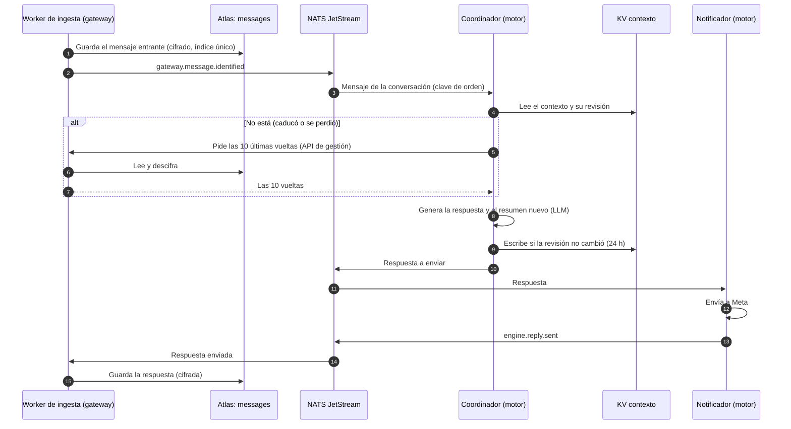
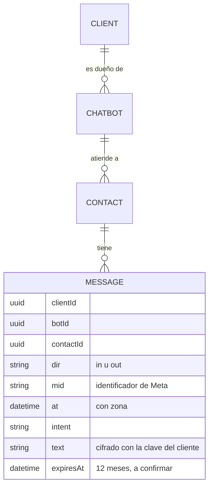

# ADR-0017: El historial de cada conversación se guarda en el gateway y su contexto vive 24 horas en NATS

* **Estado:** proposed
* **Fecha:** 2026-10-18
* **Decisores:** Jeremi Alcala
* **Fase AI-DLC:** 02-design
* **Versión:** 0.1.0
* **ID:** ADR-0017
* **Supersede:** — (amplía [ADR-0010](0010-clave-de-cifrado-de-datos-por-cliente.md) y
  [ADR-0014](0014-supresion-en-respaldos-por-caducidad.md) a un dato nuevo: el contenido de los mensajes)
* **Controles OWASP afectados:** A01 (acceso solo del cliente dueño y del worker que lo necesita), A02 (cifrado del
  contenido con una clave por cliente), A04 (retención y supresión), A09 (constancia de lo suprimido)

Propuesta para el Gate 1 del refactor ([plan](../plan-topologia-de-workers.md), paso 2).

## Contexto

Hoy nadie guarda la conversación. El motor clasifica cada mensaje aislado, sin historial, y el gateway no guarda el
texto: según la [clasificación de datos](../data-classification.md), el contenido solo pasa por la cola y caduca en
ella a las 24 horas. La topología de ocho workers le da al coordinador (worker 3) el manejo del contexto, y para eso
hace falta guardar algo.

El 2026-10-18 Jeremi decidió tres cosas:

- **El historial se puede exportar.** El cliente puede pedir las conversaciones de sus contactos.
- **El contexto caduca a las 24 horas** desde el último mensaje.
- **El contexto son las últimas 10 vueltas más un resumen.**

Son dos datos distintos. El historial es un dato de registro: tiene que durar, exportarse con el contacto (RF09),
borrarse con él (RF10) y reaparecer tras una restauración solo para borrarse otra vez. El contexto es la memoria de
trabajo del coordinador: se lee y se reescribe en cada vuelta, el resumen lo genera el LLM, y pasadas 24 horas ya no
sirve. Coincide con la ventana de atención de WhatsApp: pasado ese plazo el bot solo puede enviar plantillas (dato
de fuentes de terceros, sin confirmar en la documentación de Meta).

Lo medido el 2026-10-18 (memoria del proyecto y `revision-dual-gate-2.md`):

- Ida y vuelta a Atlas desde la red de midgard: 60 ms de mediana, p95 64 ms.
- Un contexto de 10 vueltas más resumen, cifrado con el `ClientCipher` del proyecto: unos 8,5 KB en el caso típico
  (80 caracteres por mensaje del usuario, 300 por respuesta, 600 de resumen), 27 KB en el cargado y 121 KB en el
  máximo (4096 por mensaje, el límite de WhatsApp).
- Un mensaje del historial, cifrado: 436 B uno típico entrante, 748 B una respuesta típica y 6,1 KB uno de 4096
  caracteres.

## Decisión

### 1. El historial lo guarda el gateway, en Atlas, cifrado con la clave del cliente

- **Una colección `messages`, un documento por mensaje**, en los dos sentidos: `clientId`, `botId`, `contactId`
  (el uuid del contacto, nunca el número ni el PSID), sentido (`in` u `out`), el identificador de Meta, la hora con
  zona, el intent si lo hay y el texto. El texto se cifra con la clave de datos del cliente (AES-256-GCM,
  [ADR-0010](0010-clave-de-cifrado-de-datos-por-cliente.md)), ligado al campo `Message.text`, como los números.
- **Lo escribe el worker de ingesta**, que ya es del gateway (R1 del plan). Los mensajes entrantes, al
  identificarlos. Las respuestas, al consumir el evento que publica el notificador cuando Meta acepta un envío
  (sujeto provisional `engine.reply.sent`, que se fija en el AsyncAPI 2.0.0). El motor no necesita credenciales
  de Atlas.
- **Un índice único por bot, sentido e identificador de Meta.** Guardar dos veces el mismo mensaje no duplica nada,
  y deja deduplicado en el mismo sitio lo que Meta reintenta durante 7 días (el plan dejaba esa deduplicación al
  consumidor).
- **Retención, como propuesta: 12 meses por mensaje como máximo**, que cada cliente puede acortar, con un índice de
  caducidad (`expiresAt`). **A confirmar:** es la misma cifra que la inactividad de un contacto (RNF05), pero
  aplicada a cada mensaje.
- **Se exporta con el contacto** (`GET /chat/{bot_id}/contacts/{contact_id}` lo incluye) y **se borra con él**,
  con su bot y con su cliente. El registro de supresiones lo cubre igual que al resto. En los respaldos, el
  contenido desaparece cuando caducan, a los 365 días como mucho
  ([ADR-0014](0014-supresion-en-respaldos-por-caducidad.md)).
- **El coordinador lo pide por la API de gestión** cuando su contexto no está: las últimas 10 vueltas de una
  conversación, con su credencial de worker (D3, [ADR-0016](0016-credencial-del-motor-por-cliente.md)) y una ruta
  nueva limitada a eso.

### 2. El contexto lo guarda el coordinador, en un bucket KV de NATS JetStream, 24 horas

- **Un bucket `contexto`**, con una clave por conversación: `<clientId>.<botId>.<contactId>`. La clave no lleva
  ningún dato personal.
- **El valor tiene las últimas 10 vueltas, el resumen, el estado** (intent en curso, datos recogidos, acción
  pendiente de confirmar) y el último identificador de Meta procesado, que sirve para el orden y para no procesar
  un mensaje dos veces.
- **Caducidad del bucket a 24 horas** (`max_age`). Cada escritura de una conversación renueva su plazo. **A
  comprobar con una prueba** antes de aceptar la ADR: la documentación de NATS no dice si la edad se cuenta desde
  la última escritura de cada clave. La caducidad por clave no sirve para esto, porque solo se fija al crear la
  clave (servidor 2.11 o posterior).
- **Una sola revisión por clave**, valor de 256 KB como máximo (el caso máximo medido ocupa 121 KB) y un tope de
  tamaño del bucket que se fija con el placement de NATS.
- **Escritura condicionada a la revisión leída** (*compare-and-swap*). Con la clave de orden por conversación del
  plan solo un coordinador atiende cada conversación a la vez; si dos chocan, el segundo vuelve a leer y aplica su
  cambio encima.
- **Cifrado con una clave por cliente distinta de la del gateway:** una clave `contexto` de Transit en Andvari,
  derivada por cliente, a la que solo llega el AppRole del coordinador, para cifrar y descifrar y nada más. El
  coordinador nunca recibe las claves de datos del gateway.
- **Solo el usuario NATS del coordinador** lee y escribe el bucket (permisos por sujeto sobre `$KV.contexto.>`,
  R8 del plan).
- **El bucket no se respalda.** Si se pierde (el disco de midgard, un reinicio sin escribir), el coordinador lo
  rehace con las 10 últimas vueltas del historial y vuelve a generar el resumen. El historial es la fuente de
  verdad; el contexto, una copia de trabajo.
- **La supresión llega por el bus.** Cuando el gateway borra un contacto, un bot o un cliente, publica un evento
  (sujeto provisional `gateway.contact.erased` y sus equivalentes), y el coordinador borra las claves de ese
  prefijo. Si el evento se pierde, la caducidad lo borra en 24 horas como mucho.

Una vuelta de la conversación, con los dos almacenes (eje comportamiento, fase 02-design):

Lo que se guarda de cada mensaje del historial (eje estructura, fase 02-design):

## Alternativas consideradas

| Opción | Por qué no |
|---|---|
| Todo en Atlas: historial y contexto | El motor necesitaría credenciales de Atlas, o el gateway una ruta para escribir el contexto en cada vuelta. El contexto (resumen generado, estado) caería en los respaldos de 365 días, cuando a las 24 horas ya no sirve. La latencia no es el problema: 2 viajes, unos 120 ms frente a varios segundos de LLM |
| Contexto derivado del historial en cada vuelta, sin almacén propio | Una llamada a la API de gestión por vuelta, que ata cada respuesta a Atlas y a Andvari. El resumen y el estado tendrían que guardarse en otro sitio de todos modos |
| Redis o Valkey para el contexto | Un componente más en un servidor de 7,6 GB de RAM, con su propia persistencia, credenciales y respaldo. NATS ya está decidido (D1) y su KV da caducidad y escritura condicionada |
| Contexto cifrado con la clave de datos del gateway | El coordinador tendría que recibir las claves de datos de los clientes, que hoy solo abre el gateway. Una clave de Transit propia separa lo que cada uno puede leer |
| Historial sin cifrar, como los nombres | El contenido es dato restringido y puede incluir categorías especiales (art. 9 GDPR): va cifrado, como los números |

## Consecuencias

- **El contenido de los mensajes pasa a guardarse en MongoDB.** La clasificación de datos dice hoy lo contrario y se
  reescribe. El threat model suma un almacén y un límite de confianza (el bucket), y AB14 (supresión en cola, logs
  y respaldos) suma el historial y el contexto.
- **El crecimiento de Atlas lo marca el historial, no el contexto.** Una vuelta típica (entrante más respuesta) son
  unos 1,35 KB con sus índices (estimado; los 1,2 KB de los dos documentos están medidos):

  | Vueltas al día | Al día | En 12 meses de retención |
  |---|---|---|
  | 1.000 | 1,35 MB | ~0,5 GB |
  | 10.000 | 13,5 MB | ~4,9 GB |
  | 100.000 | 135 MB | ~49 GB |

  El tier Flex incluye 5 GB: con 10.000 vueltas al día se llena en un año. El tier de Atlas pasa a depender del
  volumen real de conversaciones.
- **El contexto no suma a Atlas.** Ocupa unos 8,5 KB por conversación viva en el bucket de midgard (85 MB con 10.000
  conversaciones al día).
- **Contratos nuevos:** los sujetos `engine.reply.sent` y `gateway.*.erased` en el AsyncAPI 2.0.0, la ruta del
  historial para el coordinador y el historial dentro de la exportación del contacto.
- **Trabajo en el motor**, que es otro repositorio: el coordinador con el bucket, la clave de Transit y la
  reconstrucción desde el historial; el notificador con el evento de respuesta enviada.
- **Incrementos nuevos en el plan,** detrás del worker de ingesta (I4): el historial (colección, escritura,
  exportación y supresión) y la ruta para el coordinador.

## Preguntas abiertas antes de aceptarla

1. **La retención del historial:** 12 meses por mensaje, como propongo, u otra cifra.
2. **La prueba de la caducidad del bucket:** que cada escritura renueve las 24 horas de su clave en el NATS que se
   despliegue.
3. **Los adjuntos:** si el historial guarda solo su tipo o también la URL de Meta, que caduca y puede llevar datos
   del contacto. Propuesta: solo el tipo.
