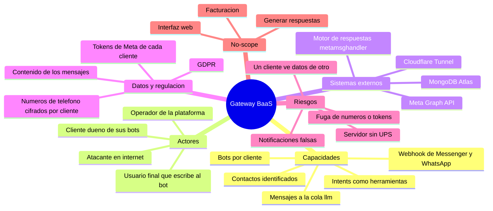

# Project Charter — Gateway BaaS (Bot as a Service) de mensajería

* **Estado:** approved (Gate 0, 2026-10-12)
* **Fecha:** 2026-10-12
* **Decisores:** Jeremi Alcala
* **Fase AI-DLC:** 00-project
* **Versión:** 0.1.0
* **Sponsor:** Jeremi Alcala
* **Owner del proyecto:** Jeremi Alcala

## Visión

Ofrecer a empresas (los **clientes**) chatbots de Facebook Messenger y WhatsApp Business como servicio: cada cliente
crea sus bots, los conecta a sus cuentas de Meta y administra los datos de sus propios bots, sin operar
infraestructura. El gateway recibe los mensajes de Meta, identifica al contacto y entrega el mensaje a un motor de
respuestas, protegiendo los datos personales de los usuarios finales conforme al GDPR.

## Alcance

- Incluye:
  - Alta y administración de bots por cliente: persona del bot, reglas, intents y números de WhatsApp.
  - Verificación del webhook ante Meta y recepción de notificaciones de Messenger y WhatsApp.
  - Identificación de contactos y publicación de cada mensaje en la cola `llm` de RabbitMQ.
  - Exposición de los intents de cada bot como herramientas para el motor de respuestas.
  - Registro de clientes y aislamiento entre ellos: cada cliente se autentica con su propio material de clave y
    solo ve y administra lo suyo.
  - Protección de datos personales: números de teléfono cifrados con una clave por cliente, y soporte a los
    derechos de acceso, supresión y portabilidad.
  - Empaquetado y despliegue continuo en el servidor propio (`midgard`), detrás de un túnel de Cloudflare.
- **No incluye (no-scope):**
  - Generar las respuestas, ejecutar las acciones que pida el usuario y enviar la respuesta al destinatario.
    Lo hace el motor de respuestas, `ms-python-metamsghandler`, un servicio aparte que consume la cola `llm`
    ([ADR-0002](adr/0002-el-motor-entrega-las-respuestas.md)).
  - Interfaz web para los clientes. La administración es por API.
  - Facturación, planes y medición de consumo.
  - Canales que no sean Messenger y WhatsApp Business.
  - Gestión de las plantillas de mensaje y de las cuentas de Meta de los clientes: se hace en Meta.

El alcance mezcla lo que ya existe con lo que falta. El gateway de hoy recibe y encola mensajes, y cada
cliente administra sus bots con su propio token; la protección de los datos en reposo es un requisito
todavía sin construir. El detalle, requisito por requisito, está en el
[PRD](../01-requirements/mvp-baas-gateway.md).

## Mapa mental del alcance

*Eje trazabilidad · fase 00 · Gate 0.*

## Stakeholders

| Rol | Nombre | Responsabilidad |
|---|---|---|
| Sponsor, owner y operador | Jeremi Alcala | Decide el alcance, opera la plataforma y aprueba los gates. Encargado del tratamiento frente a los clientes. |
| Cliente | Empresas que contratan el servicio | Dueño de sus bots y responsable del tratamiento de los datos de sus usuarios finales. |
| Usuario final | Personas que escriben a un bot | Interesado: titular de los datos personales que el gateway trata. |
| Delegado de protección de datos | `<TODO: designar o confirmar que no aplica>` | Punto de contacto para clientes, interesados y autoridad de control. |

## Restricciones y supuestos

- **Servidor.** Corre en `midgard`, un appliance doméstico (i3-3240, 2 núcleos, 7,6 GB de RAM) que además enruta
  la red de la casa. El gateway tiene un tope de 512 MB y 1 CPU. No hay UPS: los cortes de luz lo apagan.
- **Meta impone el protocolo.** La verificación del webhook, la firma `X-Hub-Signature-256` y los reintentos los
  define Meta; el gateway se adapta.
- **Repositorio público.** Ningún secreto ni dato de la instalación puede vivir en el repo.
- **Supuesto: GDPR como modelo.** Se diseña como si el GDPR aplicara a todos los clientes, con el cliente como
  responsable y la plataforma como encargada. Es un modelo de diseño, no un dictamen legal.
- **Supuesto: una persona.** El operador es también quien desarrolla y aprueba. El "dual review" de la metodología
  se cubre con revisión humana más análisis asistido por IA.

## Métricas de éxito del proyecto

| Métrica | Objetivo |
|---|---|
| Aislamiento entre clientes | Ninguna prueba de acceso cruzado entre clientes pasa |
| Números de teléfono en claro en la base, los logs o los respaldos | Cero |
| Mensajes aceptados con `200` que no llegan a la cola | Cero |
| Notificaciones sin firma válida procesadas | Cero |
| Tiempo de respuesta del webhook a Meta | Sin cifra comprometida; se mide desde el primer despliegue |
| Disponibilidad mensual del webhook | Sin cifra comprometida mientras el servidor no tenga UPS; se mide desde el primer despliegue |

## Riesgos de alto nivel

| Riesgo | Por qué importa | Tratamiento |
|---|---|---|
| El modelo multi-cliente no existe en el código | Hoy cualquier poseedor de la clave única ve todos los bots y sus tokens | Cerrado: RS01 y RS02 están construidos. Falta el cifrado de los datos (RS05, RS06) antes de admitir a un cliente externo |
| Los datos personales se guardan en claro | Una fuga de la base expone números, nombres y tokens de Meta | Requisitos RS05 y RS06 |
| El ciclo no se cierra con el motor de respuestas | `ms-python-metamsghandler` está en implementación: clasifica el mensaje pero todavía no responde, no está desplegado, rechaza los mensajes de Messenger del gateway y descarta el bot de destino. Además necesitará los tokens de Meta de cada cliente para enviar | Requisitos RF07, RF12 y RS06; contrato AsyncAPI común en el Gate 1 |
| Servidor doméstico sin UPS | Un corte largo deja el webhook caído y Meta puede dejar de entregar | Aceptado con vigilancia; se revisa en el placement del Gate 1 |
| Dependencias de 2024 | FastAPI y Starlette fijados en versiones antiguas, en un servicio público | Gate 2 |
