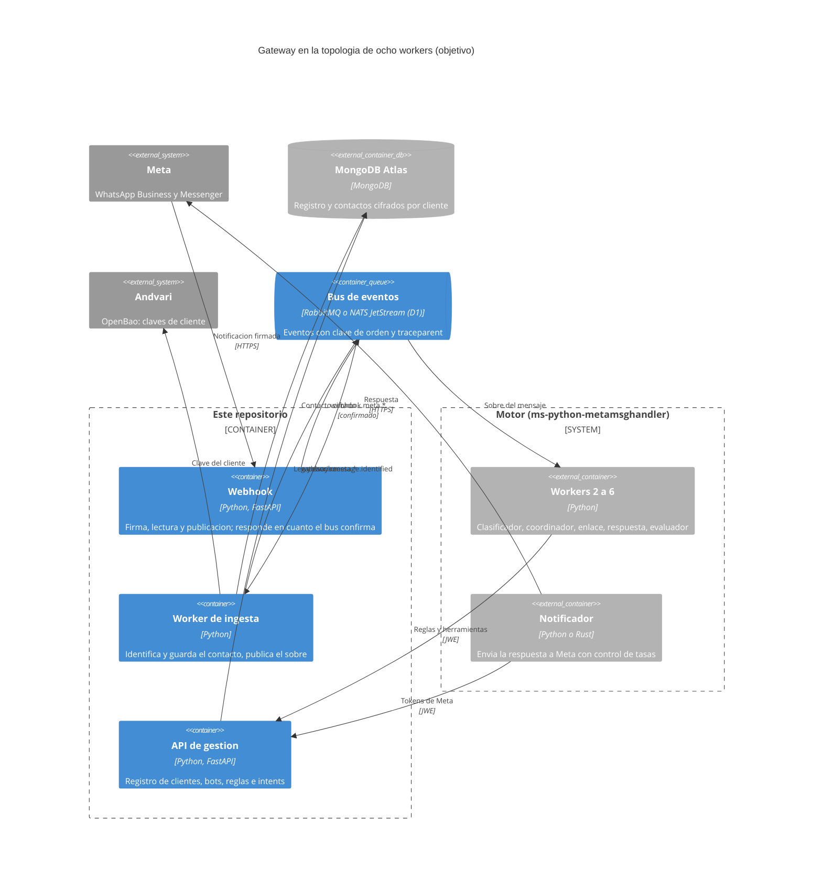
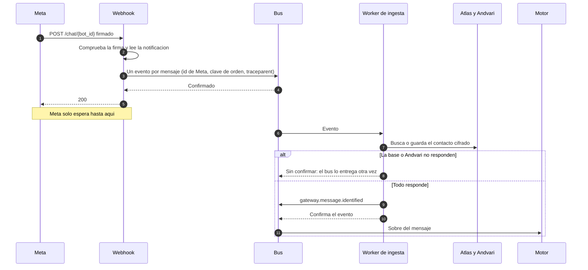
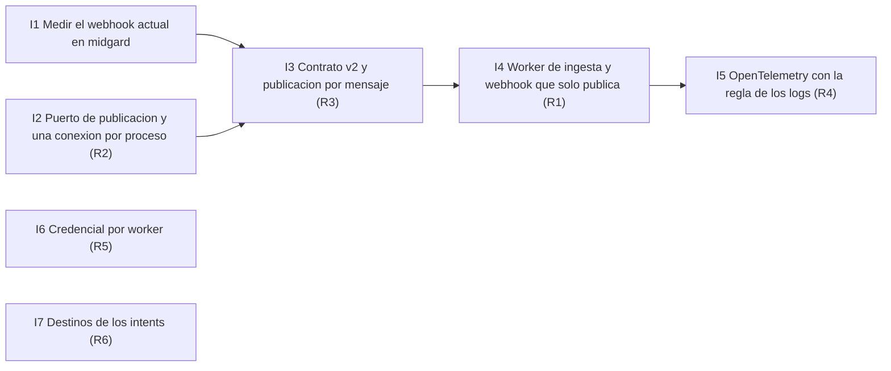

# Plan: el gateway dentro de la topología de ocho workers

* **Estado:** review
* **Fecha:** 2026-10-18
* **Decisores:** Jeremi Alcala
* **Fase AI-DLC:** 00-project
* **Versión:** 0.1.0
* **Origen:** «Análisis comparativo exhaustivo: Rust vs. Python para la arquitectura de motores de chatbots asistidos por IA» (documento externo, revisado el 2026-10-18)

Este documento revisa el análisis y planifica qué cambia en este repositorio para encajar en la arquitectura que
propone. No decide nada: las decisiones están en la sección [Decisiones](#decisiones-que-necesita-el-plan) y cada
una se convertirá en una ADR cuando se tome.

## Qué propone el análisis

Un motor de chatbots partido en ocho workers que se hablan por un bus de eventos (NATS JetStream con enrutamiento
por sujetos), cada uno en el lenguaje que mejor le sirve:

| # | Worker | Lenguaje propuesto | Quién lo tiene hoy |
|---|---|---|---|
| 1 | Webhook de recepción | Python | **Este repositorio** (el gateway) |
| 2 | Clasificador (guardrails) | Python | El motor, `ms-python-metamsghandler`, en un solo servicio |
| 3 | Coordinador (enrutamiento y contexto) | Python con Pydantic v2 | El motor |
| 4 | Enlace (MCP y APIs externas) | Rust (`rmcp`) | El motor |
| 5 | Respuesta (LLM) | Python | El motor |
| 6 | Evaluador (tono, certeza) | Python | El motor |
| 7 | Notificador (envío y control de tasas) | Rust, o Python con Redis | El motor (ADR-0002) |
| 8 | Auditor (OpenTelemetry) | Rust o Go | Nadie |

Al gateway le toca el worker 1, y sigue siendo además el registro de clientes, bots, reglas, intents y contactos
cifrados (ADR-0004, ADR-0010, ADR-0012): el análisis no dice dónde vive esa configuración, y los workers 2 a 7 la
leen de aquí.

## Revisión del análisis

### Lo que se sostiene

- **El plazo de Meta es real y es más exigente que lo que tenemos escrito.** La página de
  [throughput de WhatsApp Cloud API](https://developers.facebook.com/documentation/business-messaging/whatsapp/throughput),
  consultada el 2026-10-18, pide al webhook una latencia mediana de 250 ms como máximo y menos de un 1 % por
  encima de 1 s, aguantar el tráfico entrante esperado y el triple del saliente, y fija 80 mensajes por segundo
  por número, ampliables a 1000. RNF01 del [PRD](../01-requirements/mvp-baas-gateway.md) no compromete ninguna
  cifra; esta es la que hay que adoptar para WhatsApp.
- **El webhook se queda en Python.** Coincide con lo construido y con lo que hace falta: el trabajo es de E/S.
- **La validación HMAC** que describe es la que ya hace el gateway (ADR-0004, ADR-0007), sobre los bytes crudos y
  en tiempo constante.
- **Pydantic v2 sobre los bytes.** El gateway ya lee la notificación con `model_validate_json` sobre el cuerpo
  crudo (`controller/incoming.py`), como recomienda para el coordinador.
- **La propagación del contexto de traza (W3C `traceparent`) dentro del mensaje** es lo que falta hoy para seguir
  un mensaje de Meta a la respuesta.

### Lo que no se sostiene o falta

- **No evalúa RabbitMQ, que es el broker que ya está desplegado** (Hermod, ADR-0006, ADR-0011). Compara Redis
  Streams, Kafka y NATS. Los argumentos que da a favor de NATS —enrutamiento jerárquico, entrega al menos una vez,
  límite de mensajes en vuelo, plazo de confirmación— los cubre también RabbitMQ con intercambios `topic`,
  confirmaciones del consumidor y `prefetch`. Lo que sí distingue a JetStream para este caso es la
  deduplicación al publicar (`Nats-Msg-Id`, con una ventana de 2 minutos por defecto según la
  [documentación de NATS](https://docs.nats.io/jetstream/model_deep_dive)) y un servidor más ligero. Ninguna de
  las dos cosas obliga a cambiar: la decisión está abierta (D1).
- **La ventana de deduplicación no cubre los reintentos de Meta.** WhatsApp reintenta durante 7 días (ADR-0015);
  la ventana de JetStream es de minutos y no conviene agrandarla. El consumidor tiene que deduplicar por `botId` y
  `messageId` igual, con NATS o sin él.
- **El orden de la conversación no aparece.** Con ocho workers asíncronos y varios consumidores por etapa, dos
  mensajes seguidos de la misma persona pueden contestarse al revés. Hace falta una clave de orden por
  conversación (bot y remitente) que el bus respete, y el contrato tiene que llevarla.
- **El benchmark de MCP mide servidores, y el worker de enlace es sobre todo cliente.** Los 259 frente a 4845
  peticiones por segundo comparan servidores MCP bajo estrés; un cliente que espera a APIs remotas está limitado
  por esas APIs, no por el lenguaje.
- **El *confused deputy* no se neutraliza en compilación.** Validar el esquema de la entrada de una herramienta
  (con `schemars` o con Pydantic) rechaza entradas mal formadas, no acciones bien formadas que el LLM no debía
  pedir. La defensa es de autorización: a qué destinos puede llamar cada bot y con qué credencial. Es la amenaza
  T11 del [threat model](../02-design/threat-model.md) (intents que apuntan a la red interna), y le toca al
  gateway validar esos destinos al registrarlos.
- **El argumento de memoria supone cientos de réplicas en Kubernetes.** El despliegue es un servidor propio con
  topes de 512 MB y 1 CPU (ADR-0008, RNF03). Un segundo lenguaje duplica la cadena de herramientas y los gates del
  CI (`pip-audit` y `cargo-audit`, dos configuraciones de CodeQL) para una sola persona.
- **El plazo de 250 ms es de WhatsApp.** El análisis lo extiende a Messenger e Instagram; para Messenger lo
  documentado es la baja de la suscripción tras una hora de fallos (ADR-0015). Instagram no está en el alcance
  del gateway (D4).
- **No trata el carácter multi-cliente ni el GDPR.** El bus llevará datos personales (números, texto de los
  mensajes) entre más servicios; cada worker nuevo es un sitio más que entra en la clasificación de datos y en el
  derecho de supresión.
- **Fuentes.** Varias citas son foros, blogs o un documento de Scribd; las cifras de rendimiento de FastAPI y Axum
  son genéricas, no de este servicio.

## Por qué el webhook actual no cumple el plazo

Por cada mensaje de una notificación, y uno detrás de otro, el webhook hace hoy (`controller/messages.py`):

1. En Messenger, una llamada a la Graph API para el perfil del contacto, con 5 s de plazo (`controller/facebook.py`).
2. Lecturas y escrituras en MongoDB Atlas, y el descifrado de la clave del cliente en Andvari si no está en caché.
3. Una conexión nueva a RabbitMQ, con su negociación, `queue_declare` y confirmación (`controller/amqp_broker.py`).

Y solo entonces responde. Una notificación puede traer hasta 1000 mensajes. Sin medir todavía, una sola llamada
lenta a la Graph API basta para salir del 1 % por encima de 1 s, y la conexión por mensaje multiplica el coste de
publicar por el número de mensajes.

## Lo que cambia en este repositorio

| # | Cambio | Por qué | Toca |
|---|---|---|---|
| R1 | **El webhook responde en cuanto el bus confirma el evento verificado.** Comprobar la firma, leer la notificación, publicar un evento por mensaje y contestar. La identificación del contacto (Graph API, MongoDB, cifrado) pasa a un worker de ingesta de este mismo repositorio, que consume ese evento y publica el sobre que hoy va a la cola `llm` | Plazo de 250 ms; los fallos de la base o de Andvari los absorbe el bus en vez de los reintentos de Meta, que en Messenger acaban dando de baja la página | ADR-0006 y ADR-0015 (se reescriben: `503` solo si el bus no confirma), RNF01, RNF02 |
| R2 | **Una conexión al broker por proceso, detrás de un puerto de publicación** (`EventPublisher`), con un adaptador por broker | Quitar la conexión por mensaje; poder cambiar de broker sin tocar el dominio (D1) | `controller/amqp_broker.py` |
| R3 | **Contrato de eventos v2:** nombres jerárquicos (`webhook.meta.whatsapp`, `webhook.meta.messenger`, `gateway.message.identified`), identificador de Meta como identificador del mensaje, clave de orden por conversación y `traceparent` en las cabeceras | Lo piden el bus por sujetos, la deduplicación, el orden y la traza | AsyncAPI 2.0.0 (incompatible con la 1.1.0), ADR-0011 |
| R4 | **OpenTelemetry en el gateway**, con la misma regla que los logs: ni números, ni texto de mensajes, ni nada que mande el llamante en los atributos de un span | Seguir un mensaje entre workers (worker 8) sin abrir una vía nueva de fuga | `logging_config`, `utils`, threat model |
| R5 | **Una credencial por worker, no una por motor.** Cada clave de servicio dice qué rutas alcanza: el notificador, los tokens de Meta; el clasificador y el coordinador, reglas y herramientas | Mínimo privilegio: hoy la clave del motor alcanza las cuatro rutas, y con ocho workers solo uno necesita los tokens | ADR-0016, `SERVICE_ROUTES` |
| R6 | **Validar los destinos de los intents al registrarlos** (sin red interna, sin esquemas distintos de `https`) | Es la defensa real contra el *confused deputy* del worker de enlace | T11, DTO de intents (H6) |

Lo que **no** cambia: el gateway sigue en Python y FastAPI, sin Rust; sigue siendo el registro y el custodio de
los datos cifrados por cliente; la autenticación (ADR-0004, ADR-0005) y el borrado (ADR-0014) no se tocan.

### Vista C4 — Container (objetivo)

Eje estructura, fase 00-project: dónde queda el gateway cuando el motor se parta en workers.

### El camino nuevo de una notificación

Eje comportamiento: qué espera Meta y qué ya no.

## Decisiones que necesita el plan

| # | Decisión | Mi recomendación | Por qué |
|---|---|---|---|
| D1 | El bus: seguir con RabbitMQ o pasar a NATS JetStream | **Seguir con RabbitMQ con un intercambio `topic` y nombres jerárquicos, y dejar NATS para cuando el motor se parta**, con el puerto de R2 para que el cambio no toque el dominio | RabbitMQ ya está desplegado y probado con confirmaciones; el análisis no lo compara; la deduplicación de JetStream no evita deduplicar en el consumidor |
| D2 | Sacar la identificación del contacto del camino del webhook (R1) | **Sí** | Es lo único que pone el plazo de 250 ms a su alcance, y además protege a Messenger de la baja por fallos de la base |
| D3 | Una credencial por worker (R5) | **Sí, con las rutas en la clave** | Mínimo privilegio; ADR-0016 ya es por cliente y esto lo afina por función |
| D4 | Instagram entra en el alcance | **No por ahora** | El análisis lo nombra de pasada; no está en el PRD ni en el motor |
| D5 | Cerrar el Gate 2 antes de empezar | **Sí: revisión dual y corte de la 0.3.0** | El refactor arranca de una línea base cerrada y los cambios se ven contra ella |

## Cómo se recorre con AI-DLC

El refactor cambia requisitos, diseño y contratos, así que no entra como un incremento más del Gate 2: reabre los
artefactos de los gates 0 y 1 como cambios sobre la línea base 0.3.0, y luego se implementa por incrementos.

| Paso | Gate | Qué se produce |
|---|---|---|
| 0 | Cierre del Gate 2 actual | Revisión dual, corte de la 0.3.0 en el CHANGELOG y tag |
| 1 | Requisitos (Gate 0) | PRD: RNF01 con 250 ms de mediana y menos de un 1 % sobre 1 s para WhatsApp; requisitos de orden por conversación y de traza; escenarios de abuso nuevos (un evento repetido, un evento fuera de orden, datos personales en el bus o en una traza); clasificación de datos con el bus y los spans |
| 2 | Diseño (Gate 1) | ADRs de D1, D2 (reescribe ADR-0006 y ADR-0015) y D3 (amplía ADR-0016); ADR-0011 y AsyncAPI 2.0.0; arquitectura con el worker de ingesta; threat model con los límites de confianza nuevos y T11 |
| 3 | Implementación (Gate 2) | Los incrementos de abajo, uno por PR a `develop` |
| 4 | Pruebas (Gate 3) | Medición de latencia contra Atlas y Hermod reales en midgard, que es la evidencia de RNF01; corte de la 0.4.0 |

Incrementos del paso 3, en este orden (eje trazabilidad: qué depende de qué):

I1 se hace primero porque da la cifra contra la que se mide todo lo demás; I6 e I7 no dependen del resto y pueden
ir en paralelo. Del lado del motor, que es otro repositorio, quedan partirlo en workers, consumir el contrato v2,
deduplicar y respetar la clave de orden.
