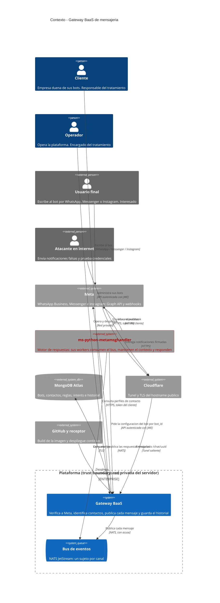
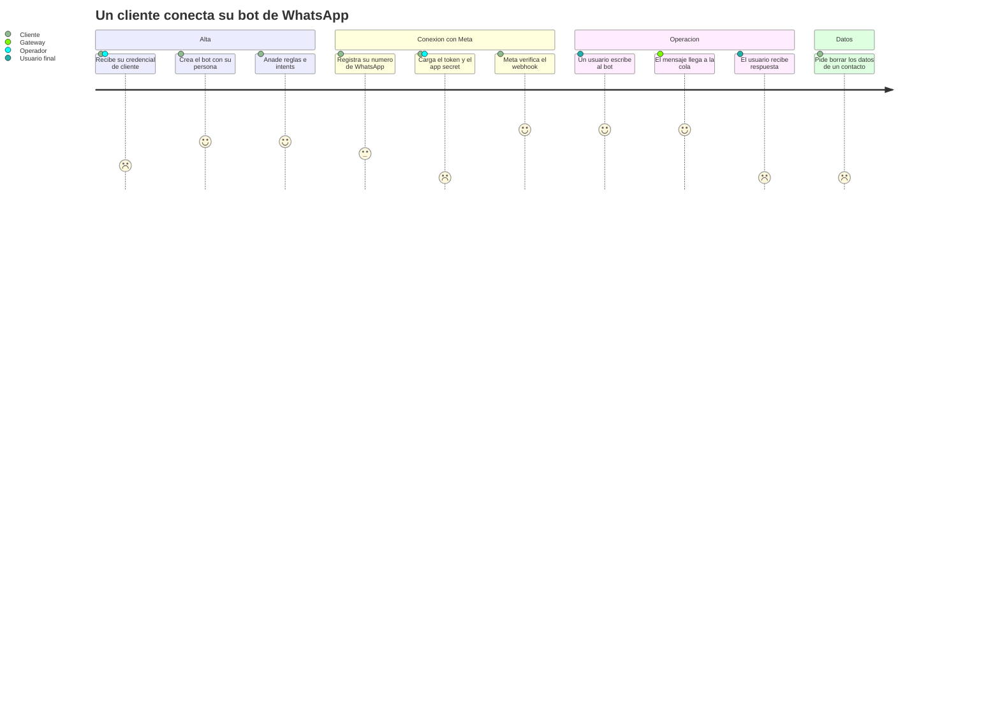
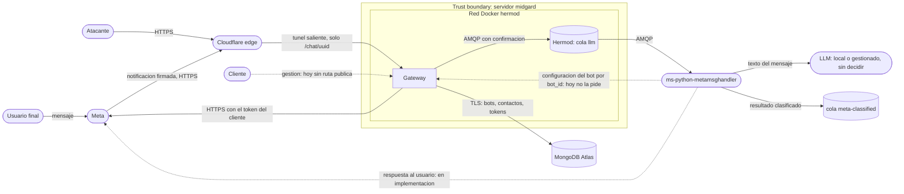
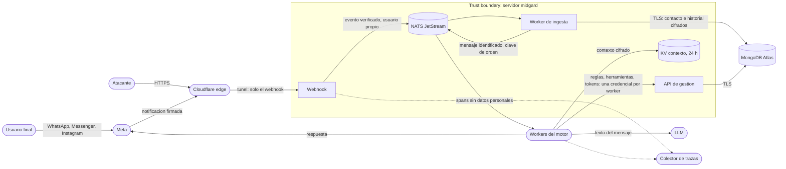
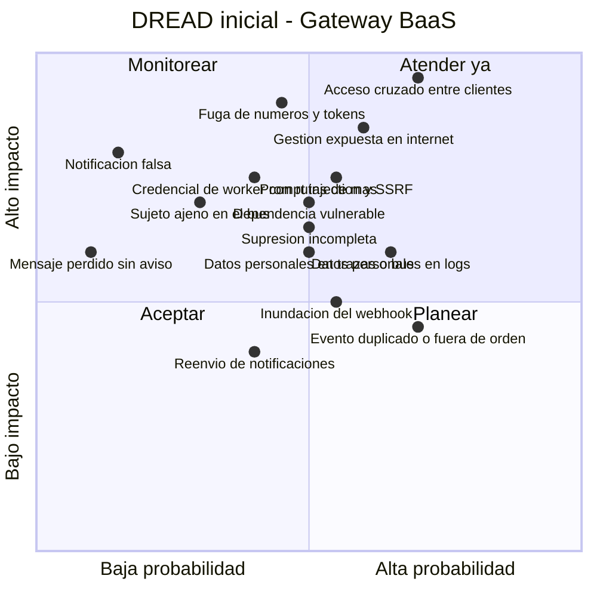

# PRD — MVP del gateway BaaS de mensajería

* **Estado:** approved (Gate 0 del refactor, 2026-10-18)
* **Fecha:** 2026-10-18
* **Decisores:** Jeremi Alcala
* **Fase AI-DLC:** 01-requirements
* **Versión:** 0.3.0
* **Gate:** 0
* **Feature ID:** BAAS-001
* **Nivel ASVS objetivo:** L2

## Problema y contexto

Una empresa que quiere atender por WhatsApp o Messenger con un bot tiene que montar un webhook público, validar a
Meta, guardar credenciales, identificar a quien escribe y conectar todo eso con un modelo de lenguaje. El gateway
ofrece esa parte como servicio (BaaS, Bot as a Service): el cliente crea su bot, lo conecta a su cuenta de Meta y
administra sus datos; la plataforma opera el webhook y entrega cada mensaje a un motor de respuestas.

El servicio existe desde 2024 como un gateway de un solo operador. Este documento es **retroactivo**: recoge lo que
ya está construido y lo que el modelo BaaS y el GDPR exigen y todavía falta. Cada requisito lleva su estado:

- **Construido** — implementado y cubierto por pruebas.
- **Parcial** — existe, pero no cumple el requisito completo.
- **Pendiente** — no existe.

"Construido" no significa probado en producción: hoy todas las pruebas son unitarias y contra dobles.

### Cambios del refactor (2026-10-18)

El gateway pasa a ser una pieza de la topología de ocho workers del [plan](../00-project/plan-topologia-de-workers.md). Las decisiones del 2026-10-18 cambian
los requisitos así:

| Decisión | Qué cambia aquí |
|---|---|
| D1: NATS JetStream en lugar de RabbitMQ | El mensaje va a un bus de eventos con un sujeto por canal; Hermod se retira al final. RS20 |
| D2: la identificación del contacto sale del webhook | El webhook solo comprueba la firma y publica; un worker de ingesta identifica al contacto. RNF01 pasa a tener cifra |
| D3: una credencial por worker | RS21 |
| D4: Instagram | RF13 |
| D6: historial exportable y contexto de 24 horas | RF14, RF15 y RNF05 ([ADR-0017](../00-project/adr/0017-contexto-de-conversacion-e-historial.md)) |
| El webhook y la gestión, por separado (RD-05) | Hecho: [ADR-0018](../00-project/adr/0018-webhook-y-gestion-por-separado.md) |

Se añaden además el orden por conversación (RNF08) y la traza de cada mensaje (RNF09, RS19), y seis escenarios de
abuso (AB17–AB22). Lo demás sigue como se aprobó el 2026-10-12.

## Objetivos / No-objetivos

Objetivos:

1. Un cliente administra sus bots y los datos de sus bots, y nadie más puede hacerlo.
2. Los números de teléfono se guardan cifrados con una clave propia de cada cliente.
3. Ningún mensaje aceptado se pierde, y ninguna notificación falsa se procesa.
4. El tratamiento de datos personales se puede defender frente al GDPR: minimización, retención, y derechos de
   acceso, supresión y portabilidad.
5. El servicio se despliega de forma reproducible, con rollback.

No-objetivos: los del no-scope del [charter](../00-project/charter.md). En particular, generar las respuestas no
es parte del gateway.

## Contexto del sistema (C4 Context)

*Eje estructura · fase 01 · Gate 0, actualizado con el refactor el 2026-10-18. Es el objetivo: hoy el bus es todavía
Hermod (RabbitMQ, cola `llm`), Instagram y el historial no existen, la gestión solo es alcanzable desde la red privada
y el motor de respuestas (en rojo) está en implementación: no está desplegado ni partido en workers, no lee las
reglas ni las herramientas del bot y todavía no envía respuestas.*

## Usuarios y escenarios

### Journey del usuario

*Eje trazabilidad · fase 01 · Gate 0. Las puntuaciones bajas son los huecos de hoy: no hay credencial por cliente,
los tokens se cargan a mano en la base, el motor clasifica el mensaje pero nadie envía la respuesta, y no existe el borrado de un contacto.*

### Escenarios positivos

| ID | Escenario |
|---|---|
| ES01 | Un cliente crea un bot, le añade reglas e intents y obtiene la URL del webhook y su token de verificación. |
| ES02 | El cliente pega esa URL y ese token en su app de Meta, y Meta verifica el webhook a la primera. |
| ES03 | Un usuario final escribe por WhatsApp; el gateway valida la firma, identifica o crea el contacto, publica el mensaje y responde `200` a Meta. |
| ES04 | El motor de respuestas pide las reglas y las herramientas del bot, genera la respuesta o ejecuta la acción que pide el usuario, y envía la respuesta por el mismo canal. |
| ES05 | El cliente exporta o borra los datos de un contacto que ha ejercido sus derechos. |
| ES06 | RabbitMQ no está disponible; el gateway responde `503`, Meta reintenta y el mensaje llega cuando vuelve. |
| ES07 | Un usuario final escribe por Instagram a la cuenta profesional del cliente; el mensaje sigue el mismo camino que los de los otros dos canales. |
| ES08 | Un usuario escribe dos mensajes seguidos; el bot responde a los dos en orden y recordando lo que se dijo antes, en la misma conversación. |
| ES09 | El cliente exporta la conversación de un contacto con el resto de sus datos. |

### Escenarios negativos / abuso (requerido por Gate 0)

| ID | Escenario | Control | Estado |
|---|---|---|---|
| AB01 | Un tercero envía al webhook una notificación sin firma, o firmada con otro secreto, para inyectar mensajes en la cola | RS03 | Construido |
| AB02 | El cliente A lee o modifica los bots, contactos o tokens del cliente B usando un UUID que conoce o adivina | RS01 | Construido |
| AB03 | Una copia de la base (volcado, respaldo, acceso indebido a Atlas) expone números de teléfono y tokens de Meta | RS05, RS06 | Construido |
| AB04 | Un tercero recorre el hostname público y encuentra `/docs`, `/openapi.json` o los endpoints de gestión | RS09 | Construido sin desplegar: el servicio que se publica no tiene esas rutas (ADR-0018), y la documentación solo se sirve en `development` |
| AB05 | Un bot en internet prueba credenciales de gestión o tokens de verificación | RS02, RS04, RS10 | Parcial |
| AB06 | Alguien reenvía una notificación legítima capturada: la firma de Meta no caduca | RNF04 | Parcial: el sobre lleva el identificador de Meta; falta que el motor deduplique |
| AB07 | Una ráfaga de notificaciones agota el worker o llena la cola | RS10, RNF03 | Pendiente |
| AB08 | Un usuario final escribe instrucciones para que el LLM invoque herramientas del cliente en su contra (prompt injection) | RS16 | Pendiente |
| AB09 | Un cliente define un intent cuya llamada a API apunta a la red interna de la plataforma (SSRF a través del ejecutor de herramientas) | RS16 | Pendiente |
| AB10 | Quien tiene acceso a los logs lee conversaciones, nombres y números | RS07 | Construido |
| AB11 | El broker cae y el gateway responde `200` a un mensaje que nunca se encoló | RNF02 | Construido |
| AB12 | Un cuerpo malformado o enorme provoca un error que revela detalles internos | RS11, RS15 | Construido: `413` por encima de 3 MiB, y ningún error repite lo enviado ni el texto del fallo |
| AB13 | Una dependencia vulnerable o una imagen manipulada llegan a producción | RS12 | Parcial |
| AB14 | Un interesado pide la supresión y sus datos siguen en la cola, los logs o los respaldos | RF09, RNF05 | Parcial: el contacto se borra de la base y la cola caduca a las 24 horas; en los respaldos desaparece al caducar, a los 365 días como mucho (ADR-0014), con la retención aún sin configurar en Atlas; los logs ya no llevan datos personales. Queda lo que guarde el motor |
| AB15 | El motor de respuestas, o quien robe su credencial, obtiene los tokens de Meta de todos los clientes | RS06 | Construido en el gateway: el motor tiene una clave por cliente, que solo alcanza los bots de ese cliente |
| AB16 | Alguien captura un JWE de autenticación válido y lo reenvía, o fabrica uno con la clave pública del gateway | RS02 | Construido |
| AB17 | Meta entrega la misma notificación dos veces (reintenta 7 días en WhatsApp y 36 horas en Instagram) y el bot responde dos veces | RNF04 | Parcial: cada evento lleva el identificador de Meta; falta que alguien deduplique |
| AB18 | Dos mensajes seguidos de la misma persona se procesan en paralelo y se responden en orden inverso, o con el contexto del otro | RNF08 | Pendiente |
| AB19 | Un dato personal viaja en un atributo de una traza, o en un evento del bus sin protección, y lo lee quien tiene acceso al colector o al bus | RS19 | Pendiente |
| AB20 | Un servicio comprometido publica en un sujeto ajeno, por ejemplo mensajes como si vinieran del webhook, o lee uno que no le toca | RS20 | Pendiente |
| AB21 | La credencial robada de un worker alcanza rutas que ese worker no necesita, por ejemplo los tokens de Meta desde el clasificador | RS21 | Parcial: el motor tiene una clave por cliente, no por worker (ADR-0016) |
| AB22 | La conversación exportada, o el contexto de una conversación, llega a otro cliente o a otra conversación | RS01, RF14 | Pendiente |

## Requisitos funcionales

| ID | Requisito | Estado | Verificación |
|---|---|---|---|
| RF01 | El operador registra a un cliente, y el registro le da material de clave propio con el que se autentica y con el que se controlan sus bots y sus datos por separado ([ADR-0004](../00-project/adr/0004-firma-en-el-webhook-jwe-en-el-resto.md)) | Construido: el operador da de alta al cliente con su clave pública de firma. La clave de datos por cliente llega con RS05 | — |
| RF02 | Un cliente crea y administra sus bots: persona, reglas, intents y números | Construido: cada cliente administra los suyos con su token | Pruebas unitarias de autenticación |
| RF03 | Meta verifica el webhook de cada bot con su token de verificación | Construido | `tests/unit/test_webhook_security.py` |
| RF04 | El gateway recibe notificaciones de Messenger y de WhatsApp, identifica o crea el contacto y publica el mensaje en la cola `llm` | Construido | Pruebas de los dos canales a través de la aplicación, e integración con un RabbitMQ real. Contra un MongoDB real, solo en local |
| RF05 | Con el `bot_id` del mensaje, el motor de respuestas obtiene del gateway la configuración del bot: system prompt, herramientas y token de Meta ([ADR-0003](../00-project/adr/0003-el-bot-id-es-la-llave-de-la-configuracion.md)) | Parcial: el gateway la entrega al motor en `/rules`, `/tools` y `/tokens`, con la clave que el motor tiene para el cliente dueño del bot ([ADR-0016](../00-project/adr/0016-credencial-del-motor-por-cliente.md)); el motor no la consulta todavía y descarta el `bot_id` | `tests/unit/test_service_credential.py` |
| RF06 | El cliente carga y rota las credenciales de Meta de su bot (tokens y App Secret) por API | Construido: `PUT /chat/{bot_id}/credentials` | — |
| RF07 | El motor de respuestas dispone de lo que necesita para responder al usuario final por su canal: el bot de destino, el destinatario y el token de Meta de ese bot | Parcial: el mensaje lleva el bot, su cliente y el destinatario, y el gateway entrega el token al motor en `/tokens`. El envío en sí es del motor ([ADR-0002](../00-project/adr/0002-el-motor-entrega-las-respuestas.md)) y está en implementación | — |
| RF08 | El cliente consulta los contactos de sus bots | Construido: `GET /chat/{bot_id}/contacts`, por páginas, y `POST /contacts/search` para encontrar a una persona en todos sus bots | `tests/unit/test_export_and_delete.py` |
| RF09 | El cliente exporta y borra los datos de un contacto (GDPR, arts. 15, 17 y 20) | Construido en el gateway: `GET` y `DELETE /chat/{bot_id}/contacts/{contact_id}`. El borrado no alcanza a los respaldos ni a lo que guarde el motor (AB14) | `tests/unit/test_export_and_delete.py` |
| RF10 | La baja de un bot o de un cliente borra todos sus datos (GDPR, art. 28.3.g) | Parcial: `DELETE /bot/{bot_id}` y `DELETE /clients/{client_id}` borran todo lo guardado en la base. En los respaldos, la supresión se cumple al caducar, a los 365 días como mucho ([ADR-0014](../00-project/adr/0014-supresion-en-respaldos-por-caducidad.md)), y un registro de supresiones permite repetirlas tras una restauración; falta configurar y comprobar esa retención en Atlas | `tests/unit/test_export_and_delete.py` |
| RF11 | Fusionar a `main` construye la imagen y la despliega, con rollback si la sonda de vida falla | Parcial: construido, sin ejercitar en el servidor | Prueba de despliegue con la sonda rota a propósito |
| RF12 | Todo mensaje publicado en la cola `llm`, de Messenger o de WhatsApp, lo procesa el motor de respuestas y conserva el bot al que iba dirigido | Parcial: el motor acepta los de WhatsApp, rechaza los de Messenger y descarta el bot | Comprobado el 2026-10-12 pasando al parser del motor los sobres versión 1 que el gateway publica en un RabbitMQ real: lee los de WhatsApp, rechaza los de Messenger y no conserva el bot. El lado del gateway lo fija `tests/contract/test_queue_contract.py` |
| RF13 | El gateway recibe notificaciones de Instagram (`object=instagram`), firmadas igual que las otras, identifica al contacto por su IGSID y publica cada mensaje como los de los otros dos canales (D4). La cuenta profesional se conecta con *Facebook Login* a través de la página del cliente: el bot usa el mismo token de página que para Messenger | Pendiente (I8 del plan) | Pruebas del canal a través del servicio del webhook |
| RF14 | El historial de cada conversación, mensajes entrantes y respuestas enviadas, se guarda cifrado con la clave del cliente, se exporta con el contacto y se borra con él. De un adjunto solo se guarda su tipo, nunca la URL de Meta (D6, [ADR-0017](../00-project/adr/0017-contexto-de-conversacion-e-historial.md)) | Construido: los mensajes entrantes (I4) y las respuestas que Meta aceptó (D6a) se guardan cifrados en el historial, los escribe el worker de ingesta, y se exportan y se borran con el contacto, el bot y el cliente. De un adjunto solo se guarda el tipo | — |
| RF15 | El coordinador del motor obtiene del gateway las 10 últimas vueltas de una conversación cuando su contexto no está, y recibe aviso de cada supresión para borrar el contexto que guarda (D6, [ADR-0017](../00-project/adr/0017-contexto-de-conversacion-e-historial.md)) | Construido del lado del gateway: el motor obtiene las 10 últimas vueltas con `GET /chat/{bot_id}/contacts/{contact_id}/turns` (D6b) y recibe en `SUPRESIONES` un aviso de cada contacto, bot o cliente borrado (D6c). Hasta I6, las vueltas las alcanza cualquier clave del motor, no solo la del coordinador | — |

## Requisitos no funcionales

| ID | Requisito | Estado |
|---|---|---|
| RNF01 | El webhook responde a Meta con una mediana de 250 ms o menos y menos de un 1 % de las respuestas por encima de 1 s, en los tres canales. Es un objetivo propio: la cifra viene de la guía de 360dialog, un proveedor oficial de WhatsApp, y la documentación actual de Meta no publica ninguna; solo dice que reintenta durante 7 días | Medido en midgard el 2026-10-19 sin pasar por internet. Con el webhook de I1, que identificaba al contacto: 185 ms de mediana con un contacto conocido y 415 ms con uno nuevo ([medición](../04-testing/medicion-webhook-i1.md)). Con I4, que solo publica: 8,3 ms con los dos, y 50–52 ms con 4 notificaciones a la vez. Cumple; falta medirlo en producción, con el túnel delante (Gate 3) |
| RNF02 | Una notificación recibe `200` solo cuando RabbitMQ ha confirmado el mensaje; si no, `503` | Construido. [ADR-0015](../00-project/adr/0015-que-se-responde-a-meta.md) lo amplía: `503` también si no responden la base de datos o el servicio de claves, y `200` con rastro en el log para lo firmado que no se entiende o no se puede procesar |
| RNF03 | Cada servicio del gateway tiene un tope de memoria y de CPU en el servidor | Construido (topes del compose): el webhook, 384 MB y 1 CPU; la gestión, 256 MB y media CPU ([ADR-0018](../00-project/adr/0018-webhook-y-gestion-por-separado.md)) |
| RNF04 | Un mensaje entregado dos veces por Meta, o reenviado por un tercero, no se procesa dos veces, durante todo el plazo en que Meta reintenta: 7 días en WhatsApp, 36 horas en Instagram | Parcial: cada sobre lleva el identificador de Meta (`messageId`), el mismo en cada reentrega; nadie deduplica todavía. La ventana de deduplicación de NATS es de minutos y no basta |
| RNF05 | Cada dato personal tiene un plazo de retención y se borra al vencer, también en cola, bus, logs y respaldos. Máximos de la plataforma, que cada cliente puede acortar: 24 horas para un mensaje en la cola o el bus, salvo lo que llega de Meta y aún no se ha procesado, que espera en el bus 7 días como mucho (ADR-0021), 12 meses sin actividad para un contacto, 12 meses por mensaje para el historial y 24 horas desde el último mensaje para el contexto del coordinador. Los respaldos de la base se conservan 365 días como mucho, igual para todos los clientes (ADR-0014) | Parcial: un mensaje caduca en la cola a las 24 horas; contactos y logs no se borran por plazo, y la retención de los respaldos está decidida pero sin configurar ni comprobar en Atlas. Un contacto se puede borrar a petición (RF09). Historial y contexto no existen ([ADR-0017](../00-project/adr/0017-contexto-de-conversacion-e-historial.md)) |
| RNF06 | El servicio arranca solo tras un apagón del servidor | Pendiente: no hay unidad de arranque para el gateway |
| RNF07 | Disponibilidad del webhook: sin cifra comprometida mientras el servidor no tenga UPS. Se mide desde el primer despliegue | Sin medir |
| RNF08 | Los mensajes de una misma conversación (bot y remitente) se procesan en el orden en que llegaron, también con varios consumidores por etapa: cada evento lleva una clave de orden y el bus la respeta | Pendiente (R3 del plan) |
| RNF09 | Cada mensaje se puede seguir de un servicio a otro: cada evento lleva el contexto de traza W3C (`traceparent`) y cada servicio emite sus spans con OpenTelemetry | Pendiente (R4 del plan) |

## Trazabilidad de requisitos

```mermaid
requirementDiagram
    requirement RS01 {
      id: RS01
      text: Aislamiento entre clientes
      risk: high
      verifymethod: test
    }
    requirement RS03 {
      id: RS03
      text: Notificaciones autenticadas por firma
      risk: high
      verifymethod: test
    }
    requirement RS05 {
      id: RS05
      text: Numeros cifrados con la clave del cliente
      risk: high
      verifymethod: test
    }
    requirement RS06 {
      id: RS06
      text: Tokens de Meta cifrados y no devueltos
      risk: high
      verifymethod: test
    }
    requirement RNF02 {
      id: RNF02
      text: Sin perdida silenciosa de mensajes
      risk: high
      verifymethod: test
    }
    requirement RF09 {
      id: RF09
      text: Exportar y borrar datos de un contacto
      risk: medium
      verifymethod: test
    }
    requirement RS20 {
      id: RS20
      text: Un usuario por servicio en el bus
      risk: high
      verifymethod: test
    }
    requirement RNF08 {
      id: RNF08
      text: Orden por conversacion
      risk: medium
      verifymethod: test
    }
    element FirmaWebhook {
      type: "dependencia get_signed_webhook_bot"
    }
    element PublicacionConfirmada {
      type: "modulo amqp_broker"
    }
    element PruebasSeguridadWebhook {
      type: "prueba unitaria"
    }
    element AutorizacionPorCliente {
      type: "sin construir"
    }
    element CifradoPorCliente {
      type: "sin construir"
    }
    element DerechosDelInteresado {
      type: "sin construir"
    }
    FirmaWebhook - satisfies -> RS03
    PublicacionConfirmada - satisfies -> RNF02
    PruebasSeguridadWebhook - verifies -> RS03
    PruebasSeguridadWebhook - verifies -> RNF02
    AutorizacionPorCliente - satisfies -> RS01
    CifradoPorCliente - satisfies -> RS05
    CifradoPorCliente - satisfies -> RS06
    DerechosDelInteresado - satisfies -> RF09
    element PermisosPorSujeto {
      type: "sin construir"
    }
    element ClaveDeOrden {
      type: "sin construir"
    }
    PermisosPorSujeto - satisfies -> RS20
    ClaveDeOrden - satisfies -> RNF08
```

*Eje trazabilidad · fase 01 · Gate 0. Los requisitos de riesgo alto, RF09 y, desde el refactor, RS20 y RNF08. Los
elementos "sin construir" no tienen todavía ni componente ni prueba que los verifique; tres de ellos (autorización,
cifrado y derechos) se construyeron en el Gate 2 y el diagrama no se ha vuelto a trazar.*

## Requisitos de seguridad (mapeados a OWASP ASVS)

Numeración de ASVS 4.0.3, a nivel de sección; los ítems concretos se fijan en el plan de pruebas del Gate 3.
OWASP Top 10 en su edición 2025.

| ID | Requisito | Estado | ASVS | OWASP Top 10 |
|---|---|---|---|---|
| RS01 | Un cliente solo accede a los elementos de su propio registro: sus claves, sus bots, sus contactos y sus credenciales; todo lo demás se deniega por defecto | Construido | V4.1, V4.2 | A01 |
| RS02 | Todo endpoint que no sea el webhook se autentica con un JWT firmado por el cliente y metido dentro de un JWE ([ADR-0004](../00-project/adr/0004-firma-en-el-webhook-jwe-en-el-resto.md), [ADR-0005](../00-project/adr/0005-jwt-firmado-por-el-cliente-dentro-del-jwe.md)): el gateway verifica la firma con la clave pública registrada del cliente, y el token caduca y no se puede reutilizar | Construido, también para el motor de respuestas, que se autentica con una clave por cliente ([ADR-0016](../00-project/adr/0016-credencial-del-motor-por-cliente.md)) | V2.10, V3.5, V6.2 | A07 |
| RS03 | Solo se procesan notificaciones con `X-Hub-Signature-256` válida sobre el cuerpo crudo | Construido | V2.10, V9.2 | A08 |
| RS04 | El token de verificación se compara en tiempo constante, y un bot sin token no se puede verificar | Construido | V2.10 | A07 |
| RS05 | El número de teléfono de un contacto y el número de WhatsApp de un bot se guardan cifrados con una clave propia del cliente dueño del bot, y el contacto se puede localizar sin guardar el número en claro | Construido | V6.2, V8.3 | A04 |
| RS06 | Los tokens de Meta y el App Secret de un bot se guardan cifrados; la API de gestión no los devuelve a los clientes, y solo el motor de respuestas obtiene los tokens, pidiéndolos al gateway por `bot_id` con una credencial de servicio propia y dejando registro | Construido en el gateway: cifrados, fuera de la API de gestión, y entregados solo al motor con la clave que tiene para el cliente dueño del bot, dejando una línea en el log cada vez. `tests/unit/test_service_credential.py` | V6.4, V8.3 | A04 |
| RS07 | Ningún log contiene números, nombres, contenido de mensajes ni credenciales, en ningún nivel | Construido: no se escribe en el log nada de lo que envía quien llama ni de lo que Meta envía sobre una persona; de un fallo, su tipo y su línea. El log de accesos del servidor, que escribía el token de verificación, está apagado. `tests/unit/test_logs_and_errors.py` | V7.1 | A09 |
| RS08 | El mensaje viaja y reposa protegido entre el gateway y el motor: broker en red privada, con usuario propio, y contenido cifrado | Parcial: red privada y usuario propio previstos con Hermod; el cifrado JWE existe y está desactivado | V6.2, V9.2 | A04 |
| RS09 | En internet solo se publica `/chat/<uuid>`. La gestión y la documentación de la API se quedan en red privada hasta que existan el registro de clientes y la autenticación con JWE (RS01, RS02); a partir de entonces la gestión se publica | Construido sin desplegar: el webhook y la gestión son dos servicios, y el túnel solo publica el del webhook, sin filtrar por ruta ([ADR-0018](../00-project/adr/0018-webhook-y-gestion-por-separado.md)) | V14.3 | A02 |
| RS10 | El borde limita la tasa de peticiones por origen y por bot | Pendiente | V11.1 | A06 |
| RS11 | Toda entrada se valida contra un esquema estricto y con límite de tamaño | Parcial: ninguna petición pasa de 3 MiB, y la notificación tiene que traer su tipo y sus entradas, leídas solo tras comprobar la firma (`tests/unit/test_webhook_answers.py`). Los modelos de gestión siguen rellenando lo que falta con valores de ejemplo y no acotan la longitud de sus campos | V5.1, V13.2 | A05 |
| RS12 | Imagen base por digest, dependencias fijadas y analizadas en cada build, y SBOM publicado | Parcial: imagen por digest, dependencias fijadas con hashes y analizadas en cada build; falta el SBOM | V14.2 | A03 |
| RS13 | Ningún secreto vive en el repo ni en la imagen, y el servicio no arranca sin el par de claves con el que abre los tokens | Construido | V2.10, V14.1 | A02 |
| RS14 | Queda registro de los eventos de seguridad (rechazos, altas, bajas y accesos de gestión), atribuibles a un cliente | Parcial: se registran los rechazos y cada borrado, con quién lo hizo, y los borrados quedan además en el registro de supresiones; no hay auditoría por cliente | V7.2 | A09 |
| RS15 | Un error no revela detalles internos y falla cerrado | Construido: con un fallo forzado en cada ruta de gestión, la respuesta es un `500` genérico; la respuesta a una petición mal formada no repite lo enviado. `tests/unit/test_logs_and_errors.py` | V7.4 | A10 |
| RS16 | El texto del usuario final se trata como entrada no confiable para el LLM, y las llamadas a API de los intents solo pueden ir a destinos permitidos | Parcial: según su documentación, el motor filtra la entrada con guardrails y trata la salida del LLM como no confiable; la ejecución de acciones no está construida, así que el control de destinos no existe | V5.2, V12.6 | A05, A06 |
| RS17 | El contenedor corre sin privilegios y solo puede escribir donde necesita | Construido | V14.1 | A02 |
| RS18 | El `bot_id` identifica pero no autoriza: ninguna configuración de un bot se entrega solo por conocerlo | Construido: toda la configuración exige el token del cliente dueño del bot; las únicas rutas que funcionan solo con el `bot_id` son las del webhook, que se autentican con la firma y el token de verificación de Meta | V4.2 | A01 |
| RS19 | Ni las trazas ni los eventos del bus llevan más datos personales que los necesarios: ningún atributo de un span contiene números, texto de mensajes ni nada que mande el llamante, como en los logs (RS07); el contenido de los mensajes en el bus se protege como en la cola (RS08) | Pendiente | V7.1, V8.3 | A09 |
| RS20 | Cada servicio entra al bus con su propio usuario, por TLS, y solo publica y consume en sus sujetos | Pendiente (R8 del plan) | V4.1, V9.2 | A01 |
| RS21 | Cada worker del motor tiene su propia credencial, que dice qué rutas de la API de gestión alcanza: el notificador, los tokens de Meta; el clasificador y el coordinador, reglas y herramientas (D3) | Parcial: una clave del motor por cliente que alcanza las cuatro rutas del motor ([ADR-0016](../00-project/adr/0016-credencial-del-motor-por-cliente.md)) | V4.1, V4.2 | A01 |

## Threat assessment inicial

*Eje comportamiento · DFD inicial · Gate 0. Cinco fronteras: internet ↔ Cloudflare, Cloudflare ↔ servidor (túnel
saliente), servidor ↔ Atlas (los datos personales salen del servidor), gateway ↔ motor de respuestas, que todavía
no está desplegado, y motor ↔ LLM, donde el contenido de los mensajes puede salir a un tercero. Las líneas
discontinuas son flujos que el diseño necesita y que hoy no existen. La respuesta al usuario la envía el motor,
no el gateway ([ADR-0002](../00-project/adr/0002-el-motor-entrega-las-respuestas.md)).*

DFD del objetivo del refactor, con los límites de confianza nuevos:

*Eje comportamiento · DFD del refactor · Gate 0, 2026-10-18. Fronteras nuevas: cada servicio ↔ el bus, con su
usuario y sus sujetos (RS20); motor ↔ bucket de contexto (ADR-0017); y los servicios ↔ el colector de trazas (RS19).
El historial sale del servidor hacia Atlas como el resto de los datos personales.*

*Eje trazabilidad · DREAD inicial · Gate 0. "Acceso cruzado" es probable porque el control no existe: basta un
segundo cliente. "Notificación falsa" y "Mensaje perdido" quedan a la izquierda porque sus controles ya están
construidos. El análisis completo, con STRIDE, es entregable del Gate 1. Los cuatro últimos puntos los añade el
refactor: duplicados y desorden son casi seguros con ocho workers asíncronos y reintentos de días.*

## Métricas de éxito

Las del [charter](../00-project/charter.md). Para este MVP, además: los dieciséis escenarios de abuso tienen un
control construido y una prueba que lo verifica.

## Dependencias y riesgos

- **Motor de respuestas.** RF05, RF07, RF12, RNF04 y RS16 dependen de `ms-python-metamsghandler`, un repositorio
  aparte que está en implementación. Tiene construidas la normalización, los guardrails y la clasificación de la
  intención; le falta generar y enviar la respuesta, que es responsabilidad suya ([ADR-0002](../00-project/adr/0002-el-motor-entrega-las-respuestas.md)), y no está
  desplegado. Dónde correrán él y su LLM está propuesto y sin aceptar en sus ADR-0006 y ADR-0007. Si el LLM acaba
  en un servicio gestionado, el contenido de los mensajes sale a un tercero.
- **Meta.** El protocolo del webhook y los términos de uso de WhatsApp Business los fija Meta. Instagram exige
  además verificación del negocio, la app en modo *Live* y acceso avanzado a los permisos de mensajería.
- **NATS JetStream.** Un servicio nuevo en midgard (I0 del plan), con su placement, sus usuarios y su
  retención, que se deciden en el Gate 1.
- **MongoDB Atlas.** Los datos personales viven fuera del servidor; su región y sus respaldos están sin confirmar.
- **Servidor sin UPS.** Limita la disponibilidad que se puede prometer (RNF07).

## Decisiones

### Tomadas al aprobar el Gate 0 (2026-10-12, Jeremi Alcala)

| Decisión | Resultado | Dónde queda |
|---|---|---|
| Quién entrega la respuesta al usuario | El motor de respuestas | [ADR-0002](../00-project/adr/0002-el-motor-entrega-las-respuestas.md), RF07 |
| Cómo obtiene el motor la configuración del bot | Se la pide al gateway con el `bot_id` del mensaje | [ADR-0003](../00-project/adr/0003-el-bot-id-es-la-llave-de-la-configuracion.md), RF05 |
| Autenticación | Firma de Meta solo en el webhook; JWT firmado por el cliente dentro de un JWE en el resto | [ADR-0004](../00-project/adr/0004-firma-en-el-webhook-jwe-en-el-resto.md), [ADR-0005](../00-project/adr/0005-jwt-firmado-por-el-cliente-dentro-del-jwe.md), RS02 |
| Exposición de la gestión | Privada hasta que existan el registro de clientes y el JWE; después, pública | RS09 |
| Alcance de "los números" | El número del contacto y el número del bot | RS05 |
| Nivel ASVS | L2 | Cabecera de este documento |
| Retención | Máximos de plataforma que el cliente puede acortar: 24 horas en la cola y 12 meses sin actividad para un contacto | RNF05 |
| Supresión en respaldos | Se cumple por caducidad: los respaldos de la base se conservan 365 días como mucho | [ADR-0014](../00-project/adr/0014-supresion-en-respaldos-por-caducidad.md), RNF05 |
| SLO del webhook | Sin cifra comprometida; se mide desde el primer despliegue | RNF01, RNF07 |

### Resueltas en el Gate 1 (2026-10-12, Jeremi Alcala)

| Decisión | Resultado | Dónde queda |
|---|---|---|
| Parámetros del token de autenticación | Firma `ES256`, 60 segundos de vida y un solo uso por token | [ADR-0009](../00-project/adr/0009-parametros-del-token-de-autenticacion.md), RS02 |
| Custodia de la clave de cifrado de datos | Una clave por cliente, generada y custodiada por la plataforma, con índice ciego para buscar por número | [ADR-0010](../00-project/adr/0010-clave-de-cifrado-de-datos-por-cliente.md), RS05, RS06 |
| Contrato de la cola | El sobre del gateway, versión 1, para los dos canales; deduplicación en el motor | [ADR-0011](../00-project/adr/0011-contrato-de-la-cola.md), RF12, RNF04 |
| Aislamiento entre clientes | `clientId` en cada documento y capa de repositorio obligatoria | [ADR-0012](../00-project/adr/0012-aislamiento-por-cliente-en-la-capa-de-datos.md), RS01 |

### Tomadas el 2026-10-18 para el refactor (Jeremi Alcala)

| Decisión | Resultado | Dónde queda |
|---|---|---|
| Bus de eventos (D1) | NATS JetStream en lugar de RabbitMQ | RS20; ADR en el Gate 1 |
| Identificación del contacto (D2) | Fuera del webhook, en un worker de ingesta | RNF01; ADR-0006 y ADR-0015 se reescriben en el Gate 1 |
| Credenciales del motor (D3) | Una por worker | RS21; ADR-0016 se amplía en el Gate 1 |
| Instagram (D4) | Entra en el alcance | RF13 |
| Historial y contexto (D6) | El historial se exporta; el contexto son 10 vueltas más un resumen y caduca a las 24 horas | RF14, RF15, RNF05, [ADR-0017](../00-project/adr/0017-contexto-de-conversacion-e-historial.md) (propuesta) |
| Plazo del webhook | 250 ms de mediana y menos de un 1 % por encima de 1 s | RNF01 |
| Cuánto espera en el bus lo que llega de Meta | 7 días, lo que reintenta Meta en WhatsApp | RNF05, ADR-0021 |
| Webhook y gestión | Dos servicios | [ADR-0018](../00-project/adr/0018-webhook-y-gestion-por-separado.md) |

### Tomadas al aprobar el Gate 0 del refactor (2026-10-18, Jeremi Alcala)

| Decisión | Resultado | Dónde queda |
|---|---|---|
| Retención del historial | 12 meses por mensaje como máximo, que cada cliente puede acortar | RNF05, ADR-0017 |
| Adjuntos en el historial | Solo su tipo: la URL de Meta caduca y puede llevar datos del contacto | RF14, ADR-0017 |
| Cómo se conecta Instagram | *Facebook Login* a través de la página del cliente (`graph.facebook.com` y token de página): la misma app y el mismo token que Messenger, sin una credencial nueva | RF13 |

### Datos por aportar

No cambian ningún requisito, pero siguen sin respuesta:

- Si se designa un delegado de protección de datos o se confirma que no aplica.
- La región del clúster de MongoDB Atlas, de la que depende si hay transferencia internacional.

### Entregables anteriores al primer cliente externo

- Modelo de contrato de encargo del tratamiento (GDPR, art. 28) y registro de actividades (art. 30).
- Procedimiento de aviso de brechas a los clientes (art. 33.2).
