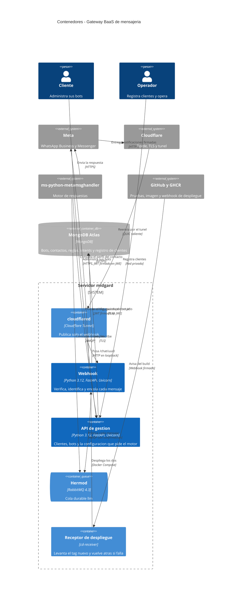
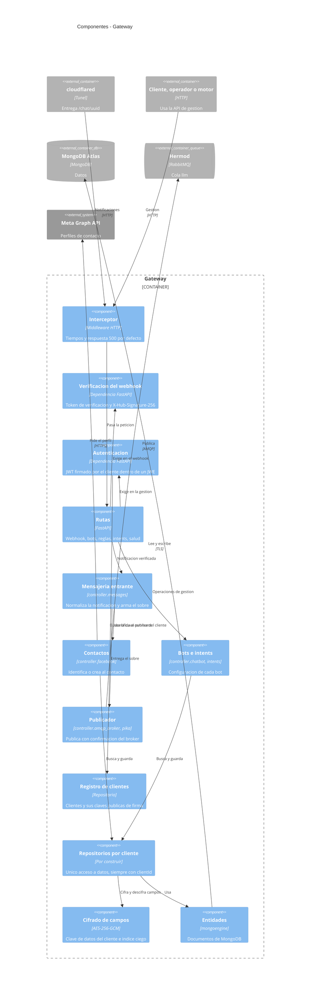
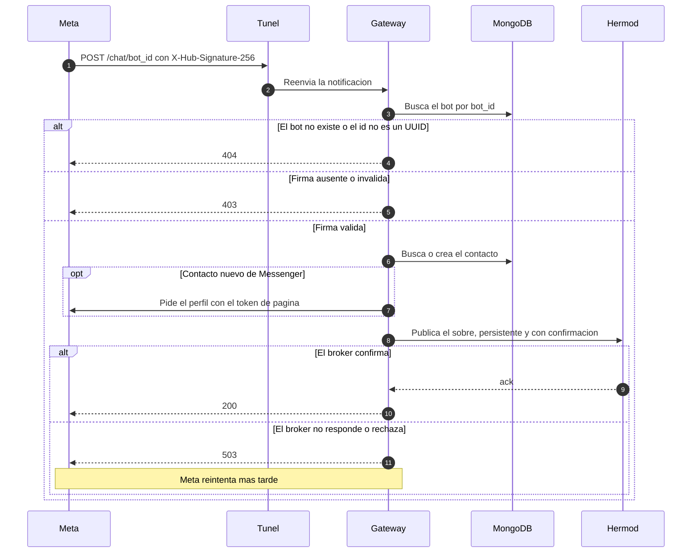
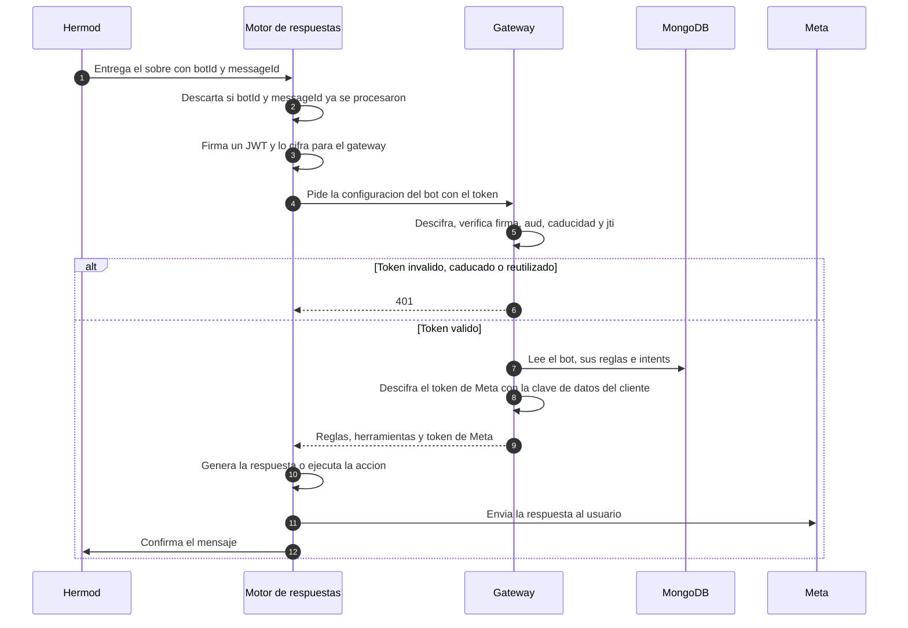
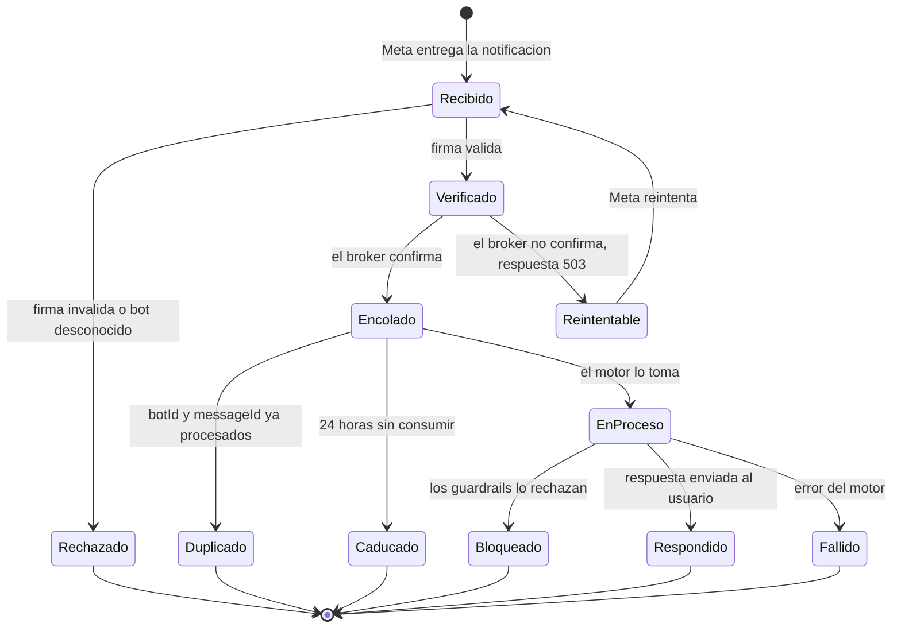
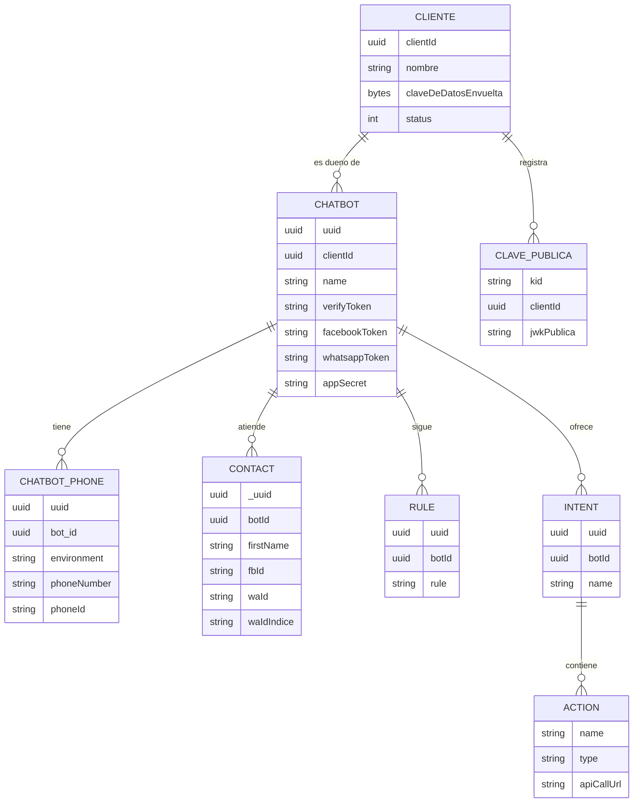
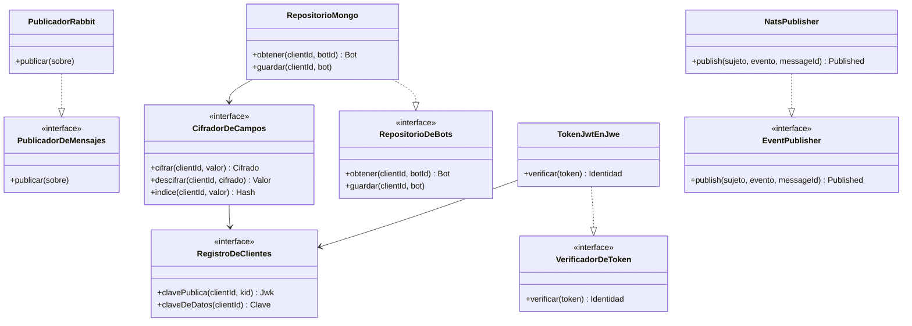
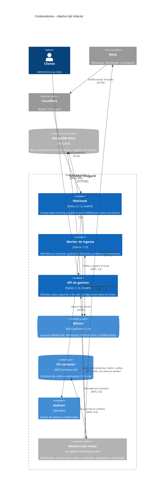
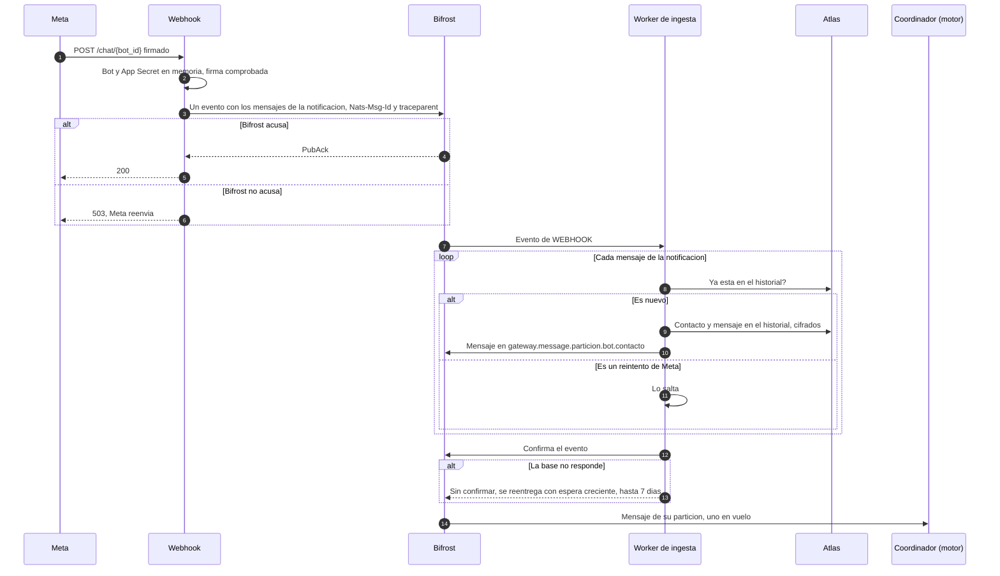
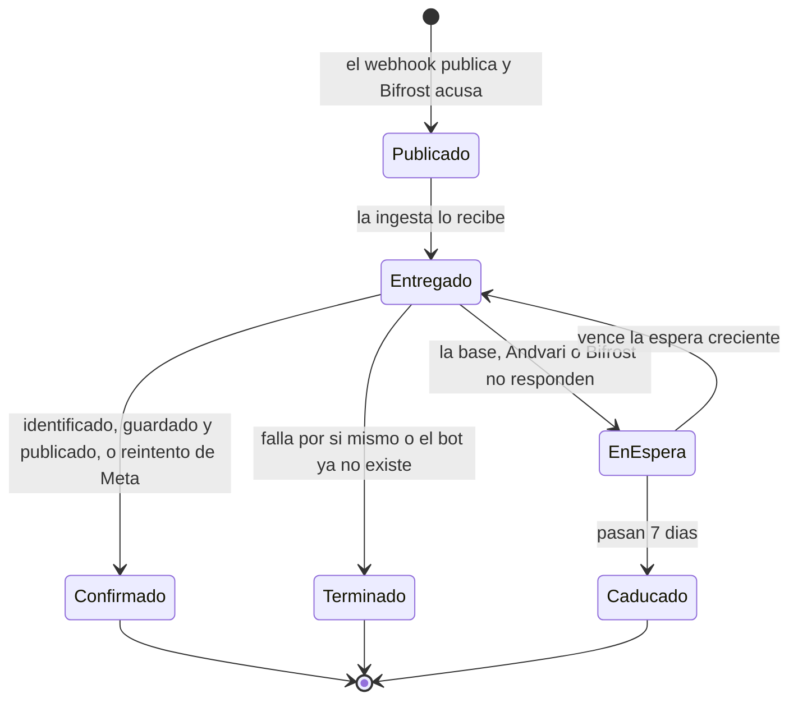

# Diseño del sistema — Gateway BaaS de mensajería

* **Estado:** approved (Gate 1 del refactor, 2026-10-18)
* **Fecha:** 2026-10-18
* **Decisores:** Jeremi Alcala
* **Fase AI-DLC:** 02-design
* **Versión:** 0.3.0
* **Gate:** 1
* **Estilo arquitectónico:** monolito modular en capas (rutas → controladores → entidades), con puertos y adaptadores como objetivo para las piezas nuevas
* **ADRs relacionadas:** ADR-0002 a ADR-0023, en [`docs/00-project/adr/`](../00-project/adr/)

Este documento describe **dos cosas a la vez**: lo que el gateway es hoy y lo que el diseño pide. En cada vista se
marca qué existe y qué falta. La lista completa de diferencias está en
[Brecha entre lo construido y el diseño](#brecha-entre-lo-construido-y-el-diseño).

## Contextos acotados (DDD)

| Contexto | Responsabilidad | Entidades núcleo | Estado |
|---|---|---|---|
| Clientes y acceso | Registrar clientes, autenticar cada petición y decidir qué puede ver cada uno | Cliente, clave pública de firma, clave de datos | Construido: registro y baja de clientes, token firmado y cifrado, aislamiento por cliente y clave de datos |
| Gestión de bots | Alta y configuración de un bot: persona, reglas, números y credenciales de Meta | `ChatBot`, `ChatbotPhone`, `Rule` | Construido, sin dueño por bot |
| Mensajería entrante | Verificar a Meta, normalizar la notificación y publicarla con confirmación | `FacebookRequest`, `MessageBody`, `QueueMessage` | Construido |
| Contactos | Identificar o crear a quien escribe; exportar y borrar sus datos | `Contact` | Construido, con el número cifrado; se listan, se buscan, se exportan y se borran |
| Intents y herramientas | Lo que un bot sabe hacer, expuesto al motor como herramientas | `Intent`, `Action`, `ApiCall` | Construido |
| Trazabilidad | Registrar cada petición y sus pasos | `Event`, `EventAction`, `Jwk` | Construido y desactivado |

## Vista C4 — Container

*Eje estructura · fase 02 · Gate 1. Es el objetivo. El webhook y la API de gestión son dos contenedores de la misma
imagen ([ADR-0018](../00-project/adr/0018-webhook-y-gestion-por-separado.md)). El acceso de los clientes ya existe, con su token. No existen
todavía: las dos relaciones del motor con el gateway y con Meta, la publicación de la gestión, y el propio
despliegue del gateway en el servidor.*

## Vista C4 — Component (gateway)

*Eje estructura · fase 02 · Gate 1. Los cuatro componentes que el diseño añadía ya están construidos: la
autenticación, el registro de clientes, la capa de repositorio y el cifrado de campos.*

## Flujos críticos (comportamiento)

### Notificación entrante

Construido tal cual, salvo la caducidad del mensaje.

*Eje comportamiento · fase 02 · Gate 1. La firma se comprueba sobre el cuerpo crudo, antes de procesar nada.*

### El motor responde a un mensaje

Flujo objetivo. Hoy el motor se detiene tras clasificar el mensaje.

*Eje comportamiento · fase 02 · Gate 1. Ver ADR-0002, ADR-0003, ADR-0009 y ADR-0011.*

## Ciclo de vida de la entidad núcleo

La entidad núcleo es el mensaje entrante, desde que Meta lo entrega hasta que se responde o caduca.

*Eje comportamiento · fase 02 · Gate 1. Hasta `Encolado` es responsabilidad del gateway y está construido. `Caducado`
lo aplica el broker, con la caducidad que el gateway pone en cada mensaje. `Duplicado` es del motor y no existe todavía
(ADR-0011). De `EnProceso` en adelante es del motor.*

## Modelo de datos y dominio

*Eje estructura · fase 02 · Gate 1. `CLIENTE`, `CLAVE_PUBLICA`, el campo `clientId` y `waIdIndice` son del diseño y no
existen. En el diseño, `verifyToken`, `facebookToken`, `whatsappToken`, `appSecret`, `phoneNumber` y `waId` se guardan
cifrados (ADR-0010). No se muestran `Event`, `EventAction`, `Jwk` ni `Credentials`, que están desactivados.*

*Eje estructura · fase 02 · Gate 1. Puertos del diseño. El publicador de RabbitMQ existe como función, no como puerto,
y se va con Hermod. `EventPublisher` y su adaptador `NatsPublisher` existen desde I2 (`src/bus`): el webhook pasa a
usarlos en I3.*

## Contratos de API

| Contrato | Fichero | Cómo se mantiene |
|---|---|---|
| API HTTP | [`contracts/openapi.yaml`](contracts/openapi.yaml) | Se genera de la aplicación con `.ai-dlc/scripts/gen_openapi.py`. Una prueba de contrato falla si deja de coincidir |
| Cola `llm` | [`contracts/asyncapi.yaml`](contracts/asyncapi.yaml) | Escrito a mano. Una prueba de contrato valida contra él el mensaje que el código publica de verdad |

Los dos describen lo que hay **hoy**. El OpenAPI no declara esquemas de seguridad porque la aplicación no los
declara. El AsyncAPI describe el sobre versión 1 de ADR-0011, que es lo que el gateway publica: un sobre por cada
mensaje, con el identificador de Meta y una caducidad de 24 horas.

Autenticación por superficie:

| Superficie | Hoy | Diseño |
|---|---|---|
| `GET` y `POST /chat/{bot_id}` | Token de verificación y firma de Meta | Igual (ADR-0004) |
| `GET /health` | Sin autenticación; solo en loopback | Igual |
| Resto de endpoints | JWT firmado por el cliente dentro de un JWE: construido | JWT firmado por el cliente dentro de un JWE (ADR-0005, ADR-0009) |

## Objetivo del refactor (Gate 1 del refactor, 2026-10-18)

Lo que cambia con la topología de ocho workers del [plan](../00-project/plan-topologia-de-workers.md). El gateway
pasa a ser tres servicios de la misma imagen alrededor de un bus de eventos: el webhook, el worker de ingesta y la
API de gestión. Las vistas de arriba describen lo construido hasta la 0.3.0; estas, lo que se construye en los
incrementos I0 a I8.

### Vista C4 — Container (objetivo)

*Eje estructura · fase 02 · Gate 1 del refactor. En azul, los tres servicios del gateway
([ADR-0018](../00-project/adr/0018-webhook-y-gestion-por-separado.md), [ADR-0021](../00-project/adr/0021-el-webhook-solo-publica.md)).
Bifröst es [ADR-0019](../00-project/adr/0019-nats-jetstream-como-bus.md) y [ADR-0020](../00-project/adr/0020-placement-de-bifrost.md);
el bucket de contexto, [ADR-0017](../00-project/adr/0017-contexto-de-conversacion-e-historial.md). Hermod se retira
cuando el motor lea de Bifröst.*

### Notificación entrante (objetivo)

*Eje comportamiento · fase 02 · Gate 1 del refactor. El plazo de Meta (RNF01) solo incluye los pasos 1 a 5: Atlas y
la Graph API salen de él. Lo que hace el motor con el mensaje está en la secuencia de ADR-0017.*

### Ciclo de vida de un evento en el stream `WEBHOOK`

*Eje comportamiento · fase 02 · Gate 1 del refactor. "Terminado" queda en el log; "Caducado" es un mensaje perdido
después de que Meta recibiera su `200` (T27), y Gjallarhorn avisa mucho antes, a los 15 minutos sin confirmar.*

### Qué tiene cada servicio del gateway

| Servicio | Rutas o sujetos | Credenciales | Lo que no tiene |
|---|---|---|---|
| Webhook | `GET` y `POST /chat/{bot_id}`; publica en `webhook.meta.>` | Atlas (lee el bot), Andvari (abre el App Secret), su usuario de Bifröst | Las claves del gateway, el registro de supresiones, la Graph API |
| Worker de ingesta | Consume `webhook.meta.>` y `engine.reply.sent.>`; publica en `gateway.message.>` | Atlas (contactos e historial), Andvari, la Graph API con el token de página, su usuario de Bifröst | Rutas HTTP |
| API de gestión | Las 30 rutas de gestión y la de las 10 últimas vueltas; publica en `gateway.*.erased` | Atlas, Andvari, las claves del gateway, el registro de supresiones, su usuario de Bifröst | — |

### Brecha del refactor

| Incremento | Trabajo | ADR | Estado |
|---|---|---|---|
| IS | El webhook y la gestión, en dos servicios | ADR-0018 | **Hecho** |
| I0 | Bifröst en midgard, con la medición del `fsync` en su disco | ADR-0019, ADR-0020 | **Hecho** (2026-10-19): 44,5 ms por escritura; con un evento por notificación, hasta 3 MB caben en 196 ms de mediana |
| I1 | Medir el webhook actual en midgard | — | **Hecho** (2026-10-19): 185 ms de mediana con un contacto conocido, 415 ms con uno nuevo, de 357 a 472 ms con 4 a la vez ([medición](../04-testing/medicion-webhook-i1.md)) |
| I2 | Puerto de publicación sobre NATS | ADR-0019 | **Hecho** (2026-10-19): `EventPublisher` y `NatsPublisher`, una conexión por proceso; contra Bifröst, 2,1 ms de mediana por evento de 1 KB, frente a los 8,3 ms de Hermod con conexión por mensaje ([guía](../03-implementation/bus-de-eventos.md)) |
| I3 | Contrato v2 y publicación de un evento por notificación | ADR-0021, `asyncapi-v2.yaml` | **Hecho** (2026-10-19): el webhook publica `EventoWebhook` en `webhook.meta.<canal>` y, hasta I4, sigue enviando los sobres v1 a Hermod; añade unos 4 ms ([guía](../03-implementation/bus-de-eventos.md#el-evento-del-webhook-i3)) |
| I4 | Worker de ingesta, historial y webhook que solo publica | ADR-0017, ADR-0021 | **Hecho** (2026-10-19), en dos partes: I4a, el historial; I4b, el worker de ingesta y el webhook que solo publica. El webhook pasa de 185 ms a 8,3 ms de mediana; la ingesta trata 2,1 notificaciones por segundo ([guía](../03-implementation/bus-de-eventos.md#el-worker-de-ingesta-i4)) |
| I5 | OpenTelemetry con la regla de los logs | — | **Hecho** (2026-10-19): spans en los tres servicios y una traza del webhook al motor, con la regla de los logs; sin colector todavía ([guía](../03-implementation/trazas.md)) |
| I6 | Una credencial por worker | ADR-0022 | **I6a hecho** (2026-10-19): cada clave del motor dice su worker y alcanza solo sus rutas (`WORKER_ROUTES`); las claves sin worker siguen con aviso en el log ([guía](../03-implementation/autenticacion.md#dar-paso-al-motor-de-respuestas)). **I6b hecho** (2026-10-19): `ops.engine_keys` da de alta las seis claves de un cliente, con la privada en Andvari (`motor/`) y la pública por la API. Pendiente: I6c, un usuario de Bifröst por worker |
| I7 | Destinos de los intents | — | **Hecho en el gateway** (2026-10-20): `classes.destinations` valida `apiCall` al guardar y filtra las herramientas; el worker de enlace tendrá que comprobar la resolución al llamar ([guía](../03-implementation/destinos-de-los-intents.md)) |
| I8 | Instagram | — | Pendiente |

## Patrones de seguridad seleccionados (por amenaza DREAD priorizada)

| Amenaza | Patrón / Control | OWASP | ADR |
|---|---|---|---|
| T2 Acceso cruzado entre clientes | Denegar por defecto; `clientId` obligatorio en una capa de repositorio única; lo ajeno responde `404` | A01 | ADR-0012 |
| T4 Gestión expuesta | Superficie mínima: el túnel publica una sola ruta y el contenedor escucha en loopback | A02 | ADR-0008 |
| T3 Fuga de la base | Cifrado en sobre con clave por cliente; índice ciego para buscar | A04 | ADR-0010 |
| T12 Tokens al alcance del motor | Mínimo privilegio: cliente de servicio de solo lectura, con registro de cada acceso | A01 | ADR-0003, ADR-0009 |
| T8 Token fabricado o reenviado | Firmar y después cifrar; lista cerrada de algoritmos; caducidad corta y un solo uso | A07 | ADR-0005, ADR-0009 |
| T6 Datos personales en logs | Los logs registran identificadores y resultados, nunca contenido | A09 | — |
| T14 Cadena de suministro | Imagen por digest, dependencias fijadas con hashes, análisis en el pipeline y SBOM | A03 | — |
| T7 Duplicados | Consumidor idempotente, con el identificador de Meta como clave | A10 | ADR-0006, ADR-0011 |
| T1 Notificación falsa | Verificar la firma sobre el cuerpo crudo, antes de procesar; fallar cerrado | A08 | ADR-0004, ADR-0007 |
| T16 Mensaje perdido | Confirmación del broker antes de responder; reintento a cargo del emisor | A10 | ADR-0006 |
| T22 Sujeto ajeno en el bus | Mínimo privilegio en el bus: un usuario por servicio con lista `allow` de sus sujetos; TLS | A01 | ADR-0019 |
| T23, T31 Copia del disco del bus o del contexto | Cifrado en reposo: almacén de Bifröst con clave en Andvari; contexto con una clave de Transit propia | A04 | ADR-0019, ADR-0017 |
| T25 Mensajes acusados perdidos en un corte de luz | Durabilidad antes del acuse: `fsync` en cada escritura | A10 | ADR-0019 |
| T26 Duplicados y desorden | Consumidor idempotente por el historial; particiones por conversación con un mensaje en vuelo | A10 | ADR-0019, ADR-0021 |
| T27 Caída larga de la base | El bus absorbe la caída 7 días; alerta a los 15 minutos sin confirmar | A10 | ADR-0021 |
| T28 Datos personales en trazas | Las trazas siguen la regla de los logs: identificadores, nunca contenido | A09 | — |
| T29 Credencial de worker con rutas de más | Mínimo privilegio por worker: una clave por cliente y por worker | A01 | ADR-0022 |

## Brecha entre lo construido y el diseño

Lo que hay que construir para que el código cumpla este diseño, en el orden que marca el threat model.

| Orden | Trabajo | Cubre | ADR |
|---|---|---|---|
| 1 | Entidad cliente, `clientId` en cada documento y capa de repositorio. **Hecho** | RF01, RS01 | ADR-0012 |
| 2 | Autenticación con JWT firmado dentro de un JWE; retirar `X-API-Key`. **Hecho**, con el alta de clientes y la credencial del motor, una por cliente | RS02, RS06 | ADR-0005, ADR-0009, ADR-0016 |
| 3 | Clave de datos por cliente, cifrado de campos e índice ciego; migrar lo que está en claro. **Hecho**; la migración se ejecuta a mano | RS05, RS06 | ADR-0010 |
| 4 | Sobre versión 1: identificadores y fechas reales, `metadata` como objeto, `messageId`, caducidad. **Hecho** del lado del gateway; el motor tiene su parte | RF12, RNF04, RNF05 | ADR-0011 |
| 5 | Endpoints para cargar credenciales de Meta, y para exportar y borrar contactos, bots y clientes. **Hecho**; en los respaldos la supresión se cumple por caducidad, a los 365 días como mucho | RF06, RF08, RF09, RF10 | ADR-0014 |
| 6 | Logs sin datos personales, errores sin detalles, esquema estricto de la notificación y límite de tamaño. **Hecho**; los modelos de gestión siguen sin acotar | RS07, RS11, RS15 | ADR-0015 |
| 7 | Retirar el envío por WhatsApp y la mención a `/answers`, que ya no son del gateway. **Hecho** | — | ADR-0002 |

Del lado del motor, en su repositorio: aceptar el sobre para Messenger, conservar el `botId`, deduplicar, pedir la
configuración al gateway y enviar la respuesta (ADR-0002, ADR-0003, ADR-0011).
