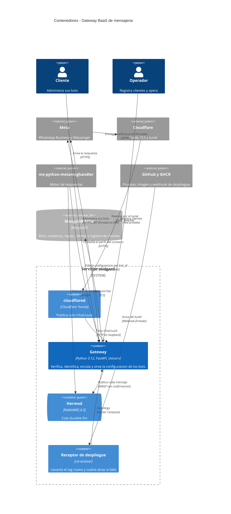
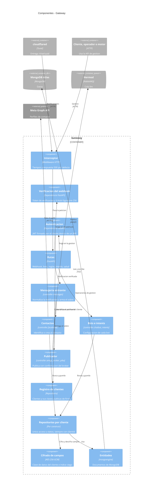
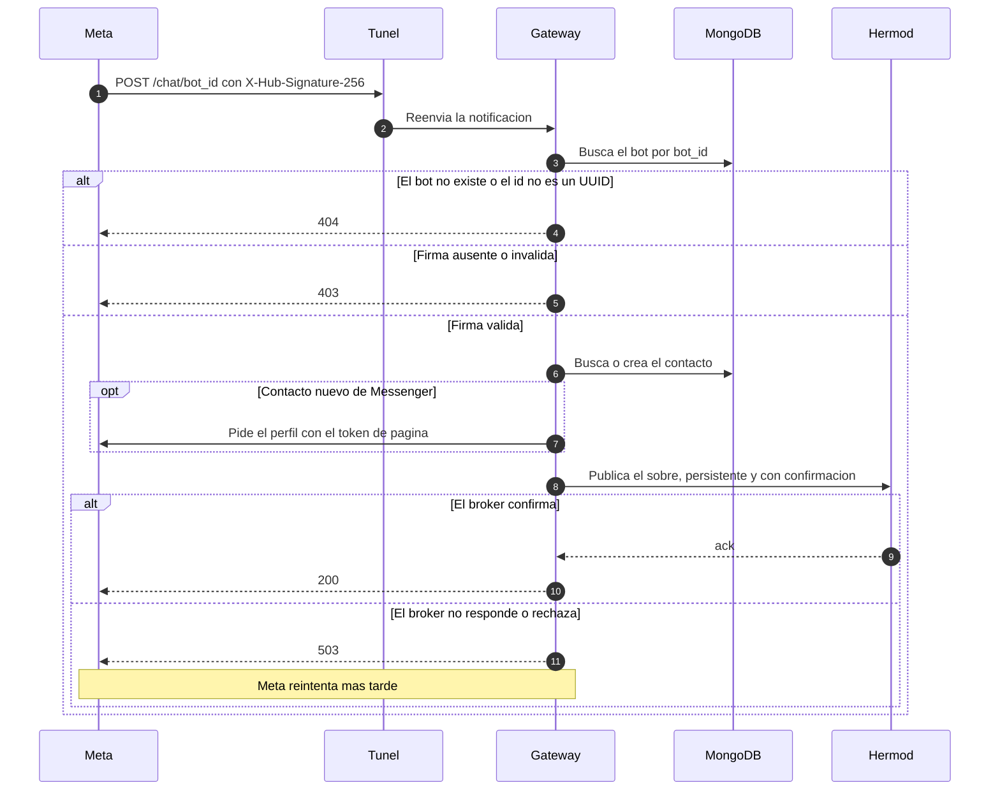
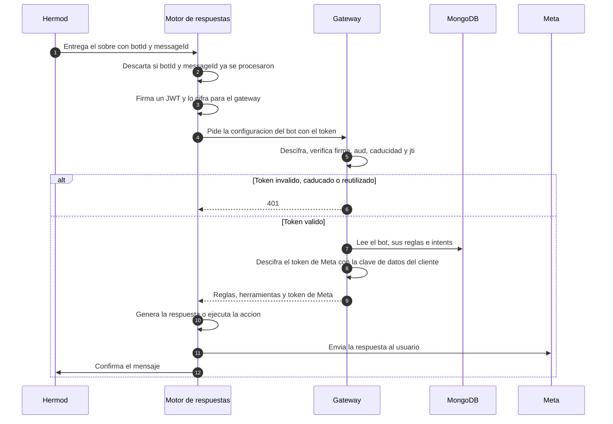
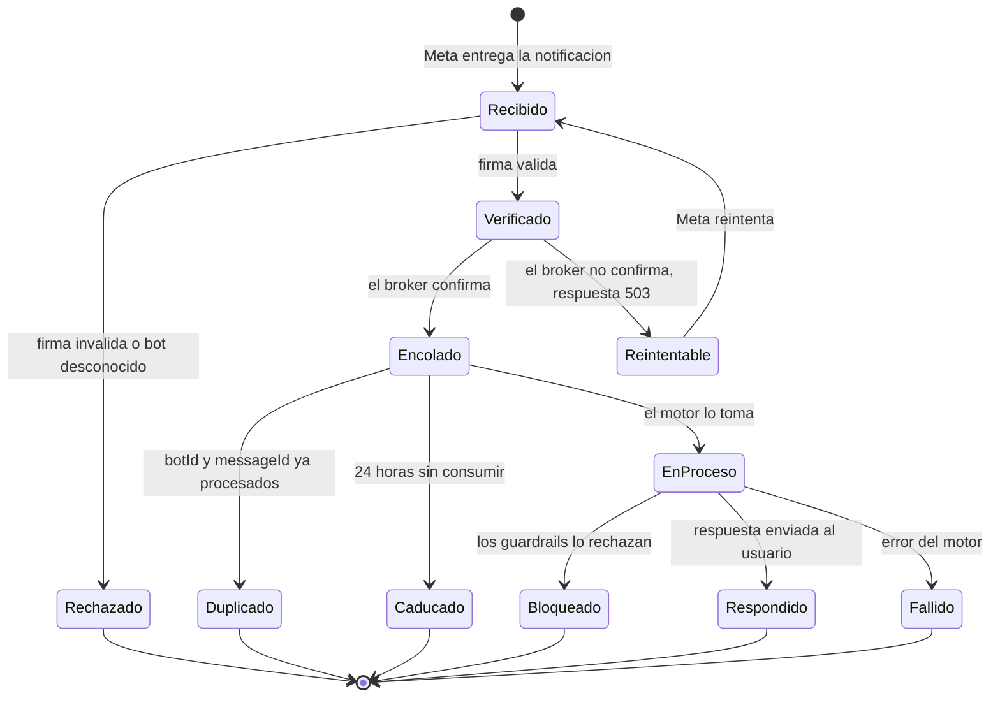
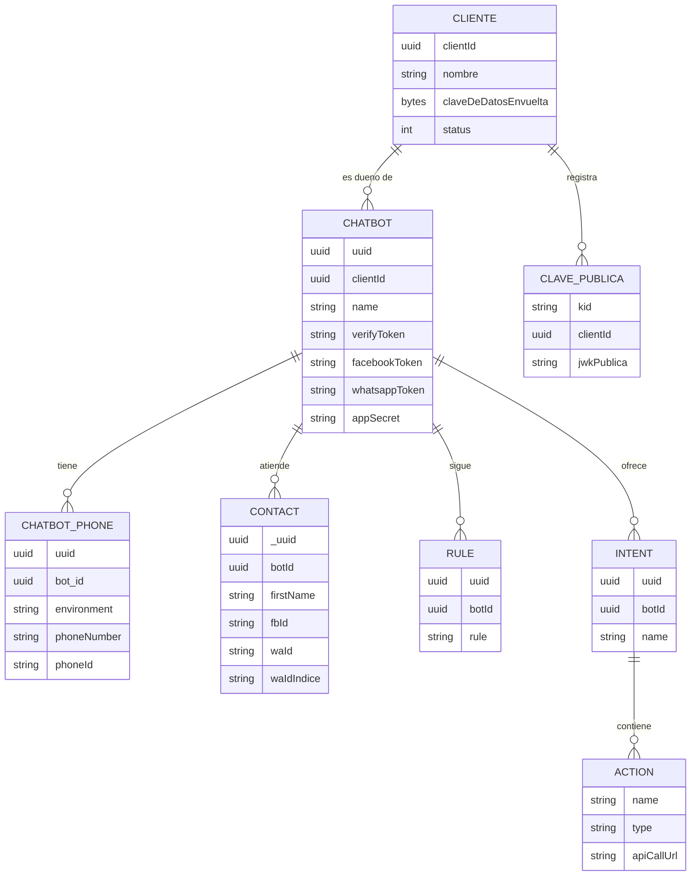
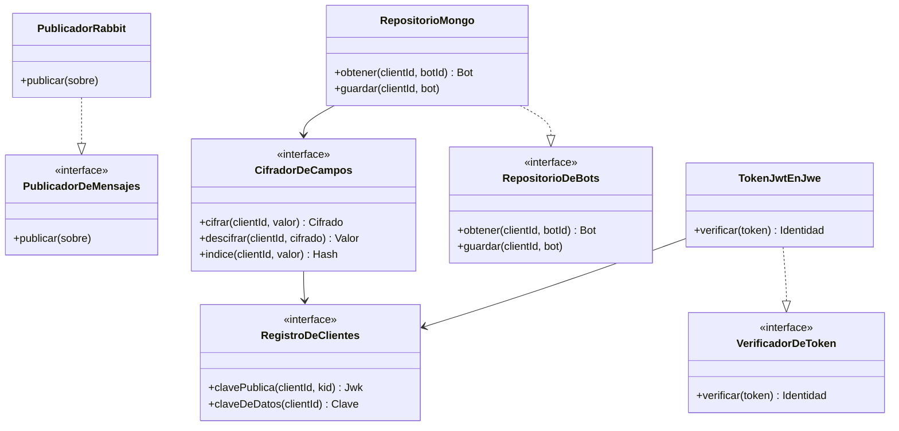

# Diseño del sistema — Gateway BaaS de mensajería

* **Estado:** approved (Gate 1, 2026-10-12)
* **Fecha:** 2026-10-12
* **Decisores:** Jeremi Alcala
* **Fase AI-DLC:** 02-design
* **Versión:** 0.2.0
* **Gate:** 1
* **Estilo arquitectónico:** monolito modular en capas (rutas → controladores → entidades), con puertos y adaptadores como objetivo para las piezas nuevas
* **ADRs relacionadas:** ADR-0002 a ADR-0012, en [`docs/00-project/adr/`](../00-project/adr/)

Este documento describe **dos cosas a la vez**: lo que el gateway es hoy y lo que el diseño pide. En cada vista se
marca qué existe y qué falta. La lista completa de diferencias está en
[Brecha entre lo construido y el diseño](#brecha-entre-lo-construido-y-el-diseño).

## Contextos acotados (DDD)

| Contexto | Responsabilidad | Entidades núcleo | Estado |
|---|---|---|---|
| Clientes y acceso | Registrar clientes, autenticar cada petición y decidir qué puede ver cada uno | Cliente, clave pública de firma, clave de datos | Construido: registro de clientes, token firmado y cifrado, aislamiento por cliente y clave de datos |
| Gestión de bots | Alta y configuración de un bot: persona, reglas, números y credenciales de Meta | `ChatBot`, `ChatbotPhone`, `Rule` | Construido, sin dueño por bot |
| Mensajería entrante | Verificar a Meta, normalizar la notificación y publicarla con confirmación | `FacebookRequest`, `MessageBody`, `QueueMessage` | Construido |
| Contactos | Identificar o crear a quien escribe; exportar y borrar sus datos | `Contact` | Construido, con el número cifrado; sin exportar ni borrar |
| Intents y herramientas | Lo que un bot sabe hacer, expuesto al motor como herramientas | `Intent`, `Action`, `ApiCall` | Construido |
| Trazabilidad | Registrar cada petición y sus pasos | `Event`, `EventAction`, `Jwk` | Construido y desactivado |

## Vista C4 — Container

*Eje estructura · fase 02 · Gate 1. Es el objetivo. El acceso de los clientes ya existe, con su token. No existen
todavía: las dos relaciones del motor con el gateway y con Meta, la publicación de la gestión, y el propio
despliegue del gateway en el servidor.*

## Vista C4 — Component (gateway)

*Eje estructura · fase 02 · Gate 1. Los cuatro componentes que el diseño añadía ya están construidos: la
autenticación, el registro de clientes, la capa de repositorio y el cifrado de campos.*

## Flujos críticos (comportamiento)

### Notificación entrante

Construido tal cual, salvo la caducidad del mensaje.

*Eje comportamiento · fase 02 · Gate 1. La firma se comprueba sobre el cuerpo crudo, antes de procesar nada.*

### El motor responde a un mensaje

Flujo objetivo. Hoy el motor se detiene tras clasificar el mensaje.

*Eje comportamiento · fase 02 · Gate 1. Ver ADR-0002, ADR-0003, ADR-0009 y ADR-0011.*

## Ciclo de vida de la entidad núcleo

La entidad núcleo es el mensaje entrante, desde que Meta lo entrega hasta que se responde o caduca.

*Eje comportamiento · fase 02 · Gate 1. Hasta `Encolado` es responsabilidad del gateway y está construido. `Caducado`
lo aplica el broker, con la caducidad que el gateway pone en cada mensaje. `Duplicado` es del motor y no existe todavía
(ADR-0011). De `EnProceso` en adelante es del motor.*

## Modelo de datos y dominio

*Eje estructura · fase 02 · Gate 1. `CLIENTE`, `CLAVE_PUBLICA`, el campo `clientId` y `waIdIndice` son del diseño y no
existen. En el diseño, `verifyToken`, `facebookToken`, `whatsappToken`, `appSecret`, `phoneNumber` y `waId` se guardan
cifrados (ADR-0010). No se muestran `Event`, `EventAction`, `Jwk` ni `Credentials`, que están desactivados.*

*Eje estructura · fase 02 · Gate 1. Puertos del diseño. De todos, solo existe hoy el publicador de RabbitMQ, y como
función, no como puerto.*

## Contratos de API

| Contrato | Fichero | Cómo se mantiene |
|---|---|---|
| API HTTP | [`contracts/openapi.yaml`](contracts/openapi.yaml) | Se genera de la aplicación con `.ai-dlc/scripts/gen_openapi.py`. Una prueba de contrato falla si deja de coincidir |
| Cola `llm` | [`contracts/asyncapi.yaml`](contracts/asyncapi.yaml) | Escrito a mano. Una prueba de contrato valida contra él el mensaje que el código publica de verdad |

Los dos describen lo que hay **hoy**. El OpenAPI no declara esquemas de seguridad porque la aplicación no los
declara. El AsyncAPI describe el sobre versión 1 de ADR-0011, que es lo que el gateway publica: un sobre por cada
mensaje, con el identificador de Meta y una caducidad de 24 horas.

Autenticación por superficie:

| Superficie | Hoy | Diseño |
|---|---|---|
| `GET` y `POST /chat/{bot_id}` | Token de verificación y firma de Meta | Igual (ADR-0004) |
| `GET /health` | Sin autenticación; solo en loopback | Igual |
| Resto de endpoints | JWT firmado por el cliente dentro de un JWE: construido | JWT firmado por el cliente dentro de un JWE (ADR-0005, ADR-0009) |

## Patrones de seguridad seleccionados (por amenaza DREAD priorizada)

| Amenaza | Patrón / Control | OWASP | ADR |
|---|---|---|---|
| T2 Acceso cruzado entre clientes | Denegar por defecto; `clientId` obligatorio en una capa de repositorio única; lo ajeno responde `404` | A01 | ADR-0012 |
| T4 Gestión expuesta | Superficie mínima: el túnel publica una sola ruta y el contenedor escucha en loopback | A02 | ADR-0008 |
| T3 Fuga de la base | Cifrado en sobre con clave por cliente; índice ciego para buscar | A04 | ADR-0010 |
| T12 Tokens al alcance del motor | Mínimo privilegio: cliente de servicio de solo lectura, con registro de cada acceso | A01 | ADR-0003, ADR-0009 |
| T8 Token fabricado o reenviado | Firmar y después cifrar; lista cerrada de algoritmos; caducidad corta y un solo uso | A07 | ADR-0005, ADR-0009 |
| T6 Datos personales en logs | Los logs registran identificadores y resultados, nunca contenido | A09 | — |
| T14 Cadena de suministro | Imagen por digest, dependencias fijadas con hashes, análisis en el pipeline y SBOM | A03 | — |
| T7 Duplicados | Consumidor idempotente, con el identificador de Meta como clave | A10 | ADR-0006, ADR-0011 |
| T1 Notificación falsa | Verificar la firma sobre el cuerpo crudo, antes de procesar; fallar cerrado | A08 | ADR-0004, ADR-0007 |
| T16 Mensaje perdido | Confirmación del broker antes de responder; reintento a cargo del emisor | A10 | ADR-0006 |

## Brecha entre lo construido y el diseño

Lo que hay que construir para que el código cumpla este diseño, en el orden que marca el threat model.

| Orden | Trabajo | Cubre | ADR |
|---|---|---|---|
| 1 | Entidad cliente, `clientId` en cada documento y capa de repositorio. **Hecho** | RF01, RS01 | ADR-0012 |
| 2 | Autenticación con JWT firmado dentro de un JWE; retirar `X-API-Key`. **Hecho**, con el alta de clientes; falta el cliente de servicio del motor | RS02 | ADR-0005, ADR-0009 |
| 3 | Clave de datos por cliente, cifrado de campos e índice ciego; migrar lo que está en claro. **Hecho**; la migración se ejecuta a mano | RS05, RS06 | ADR-0010 |
| 4 | Sobre versión 1: identificadores y fechas reales, `metadata` como objeto, `messageId`, caducidad. **Hecho** del lado del gateway; el motor tiene su parte | RF12, RNF04, RNF05 | ADR-0011 |
| 5 | Endpoints para cargar credenciales de Meta (**hecho**), y para exportar y borrar contactos y bots | RF06, RF08, RF09, RF10 | — |
| 6 | Logs sin datos personales, errores sin detalles, esquema estricto de la notificación | RS07, RS11, RS15 | — |
| 7 | Retirar el envío por WhatsApp (**hecho**) y la mención a `/answers`, que ya no son del gateway | — | ADR-0002 |

Del lado del motor, en su repositorio: aceptar el sobre para Messenger, conservar el `botId`, deduplicar, pedir la
configuración al gateway y enviar la respuesta (ADR-0002, ADR-0003, ADR-0011).
