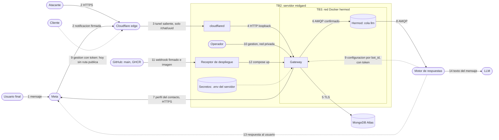
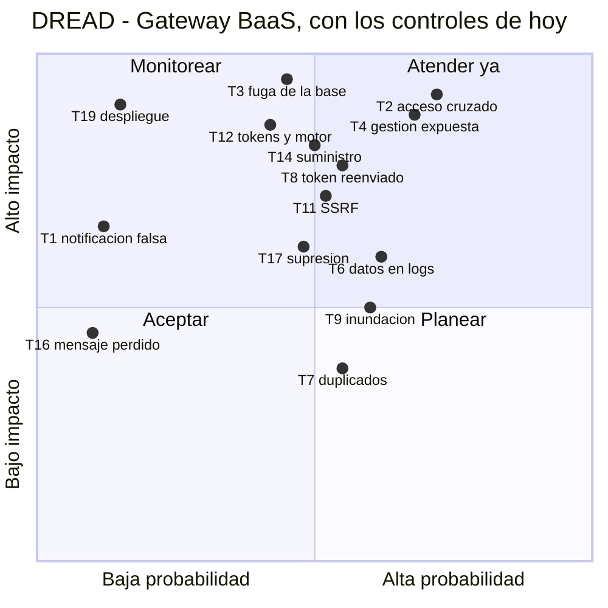

# Threat model — Gateway BaaS de mensajería

* **Estado:** approved (Gate 1, 2026-10-12)
* **Fecha:** 2026-10-12
* **Decisores:** Jeremi Alcala
* **Fase AI-DLC:** 02-design
* **Versión:** 0.2.0
* **Gate:** 1
* **Alcance:** el gateway, su cola en Hermod, su base en MongoDB Atlas, el túnel y el despliegue; el motor de respuestas solo en su frontera con el gateway
* **Metodología:** STRIDE por elemento del DFD + DREAD para priorizar
* **Clasificación de datos (ref):** [`docs/00-project/data-classification.md`](../00-project/data-classification.md)

Parte del threat assessment inicial del [PRD](../01-requirements/mvp-baas-gateway.md). Cada amenaza indica si su
control está **construido**, **parcial** o **pendiente**: este documento describe el diseño, no afirma que todo
esté hecho.

## Diagrama de flujo de datos (DFD)

*Eje comportamiento · DFD STRIDE · Gate 1. TB1 = internet ↔ Cloudflare; TB2 = el túnel entra en el servidor; TB3 =
red Docker privada del broker; TB4 = servidor ↔ Atlas; TB5 = gateway ↔ motor de respuestas; TB6 = motor ↔ LLM. Las
líneas discontinuas son flujos del diseño que hoy no existen.*

## Análisis STRIDE

| ID | Elemento | STRIDE | Amenaza | Control | Estado | Traza |
|---|---|---|---|---|---|---|
| T1 | Flujo 2/3 | S | Un tercero envía una notificación falsa para inyectar mensajes en la cola | Firma `X-Hub-Signature-256` sobre el cuerpo crudo, con el App Secret del bot; sin secreto se rechaza | Construido | RS03, ADR-0004, ADR-0007 |
| T2 | Gateway, flujo 9 | E, I | Un cliente lee o modifica bots, contactos o credenciales de otro usando su UUID | `clientId` en cada documento y capa de repositorio que lo exige; lo ajeno responde `404` | Construido | RS01, ADR-0012 |
| T3 | Base, flujo 5 | I | Una copia de la base expone números, tokens de Meta y App Secret | Cifrado de esos campos con la clave de datos del cliente e índice ciego para buscar por número | Construido | RS05, RS06, ADR-0010 |
| T4 | Flujo 3 | I, E | La gestión o la documentación de la API quedan alcanzables desde internet | El túnel publica solo `/chat/<uuid>`; el contenedor escucha en loopback | Pendiente: sin desplegar | RS09, ADR-0008 |
| T5 | Flujo 2/3, 9 | S | Fuerza bruta contra el token de verificación o las credenciales de gestión | Comparación en tiempo constante del token de verificación; para la gestión no hay secreto que adivinar, sino una firma `ES256`; límite de tasa en el borde | Parcial: falta el límite de tasa | RS02, RS04, RS10 |
| T6 | Gateway | I | Los logs contienen números, nombres y contenido de mensajes | Sin datos personales en ningún nivel de log | Construido: nada de lo que envía quien llama, ni de lo que Meta envía sobre una persona, se escribe en el log; de un fallo, su tipo y su línea, nunca su texto. Lo comprueba `tests/unit/test_logs_and_errors.py` | RS07 |
| T7 | Flujo 2/3, 6 | T | Una notificación legítima se entrega o se reenvía dos veces y se procesa dos veces | Identificador de Meta en el sobre y deduplicación en el motor durante 24 horas | Parcial: el gateway publica el identificador de Meta en `messageId`; el motor no deduplica todavía | RNF04, ADR-0011 |
| T8 | Flujo 9 | S | Alguien fabrica un token de gestión, o captura uno válido y lo reenvía | JWT firmado por el cliente dentro de un JWE; caducidad de 60 segundos y un solo uso | Construido | RS02, ADR-0005, ADR-0009 |
| T9 | Flujo 2/3 | D | Una ráfaga de notificaciones agota el worker o llena la cola | Límite de tasa en el borde; tope de memoria y CPU del contenedor; caducidad de los mensajes | Parcial: solo el tope del contenedor | RS10, RNF03, RNF05 |
| T10 | Flujo 14 | E, T | Un usuario final escribe instrucciones para que el LLM invoque herramientas del cliente | Guardrails de entrada y salida del LLM tratada como no confiable, en el motor | Parcial: según la documentación del motor; no verificado aquí | RS16 |
| T11 | Gateway, motor | E, I | Un cliente define un intent cuya llamada a API apunta a la red interna | Validar el destino de `ApiCall` al guardarlo y al ejecutarlo: solo HTTPS y sin direcciones internas | Pendiente | RS16 |
| T12 | Flujo 9 | I, E | El motor, o quien robe su credencial, obtiene los tokens de Meta de todos los clientes | Cliente de servicio con alcance de solo lectura, cada acceso registrado, credencial rotable | Pendiente | RS06, ADR-0003, ADR-0009 |
| T13 | Cola, flujo 6/8 | I, T | Quien entre en la red del broker lee o altera los mensajes | Red Docker privada y un usuario del broker por servicio; cifrado del cuerpo en una segunda fase | Parcial: la red y el broker existen; el usuario del gateway y el cifrado, no | RS08, ADR-0011 |
| T14 | Flujo 11 | T | Una dependencia vulnerable o una imagen manipulada llegan a producción | Imagen base por digest; dependencias fijadas con hashes; análisis de dependencias, de secretos y estático en el pipeline; SBOM | Parcial: falta el SBOM | RS12 |
| T15 | Secretos | I | Se filtran el `.env` del servidor, la clave privada del gateway o la clave maestra | Fuera del repo y de la imagen, permisos restringidos, y nunca impresos al diagnosticar | Parcial: la clave privada del gateway y la credencial con la que entra en Andvari son ficheros del servidor, fuera del repo y de la imagen; la clave maestra vive en Andvari y no sale de él | RS13, ADR-0008, ADR-0010 |
| T16 | Flujo 6 | D | El broker, la base de datos o el servicio de claves no están disponibles y el mensaje se pierde con un `200` a Meta | Publicación confirmada; `503` si falta algo que el servicio necesita | Construido. Una caída de más de una hora da de baja la suscripción de Messenger, y nada lo vigila | RNF02, ADR-0006, ADR-0015 |
| T17 | Base, cola, logs | I | Un interesado pide la supresión y sus datos siguen en la cola, los logs o los respaldos | Borrado por contacto, caducidad en la cola, logs sin datos personales y caducidad de los respaldos a los 365 días | Parcial: el contacto, el bot y el cliente se borran de la base y la cola caduca a las 24 horas. Los logs ya no llevan datos personales, y cada borrado se apunta en un registro con el que se repite tras restaurar un respaldo. Queda lo que guarde el motor; y en los respaldos, la retención de 365 días está decidida pero sin configurar ni comprobar en Atlas | RF09, RF10, RNF05, ADR-0014 |
| T18 | Gateway | I | Un error devuelve detalles internos en la respuesta | Respuesta de error genérica y fallo cerrado | Construido: con un fallo forzado en cada ruta de gestión, la respuesta es un `500` sin el texto del fallo; la respuesta a una petición mal formada no repite lo enviado (H12) | RS15 |
| T19 | Flujo 11/12 | T, E | Un commit malicioso en `main` se construye y se despliega solo | `main` solo admite pull requests, desde ramas permitidas; las pruebas condicionan la imagen; rollback si falla la sonda de vida | Construido; el despliegue en el servidor está sin ejercitar | RF11, ADR-0008 |
| T20 | Gateway | R | No se puede saber qué cliente hizo qué | Registro de eventos de seguridad atribuido al cliente autenticado | Parcial: se registran los rechazos, y cada borrado queda en el log y en el registro de supresiones | RS14 |
| T21 | Flujo 2/3 | D, T | Un cuerpo malformado o enorme provoca errores o consume memoria | Esquema estricto de la notificación y límite de tamaño | Construido en el servicio: ninguna petición pasa de 3 MiB, el cuerpo del webhook no se lee sin firma válida, y una notificación tiene que traer su tipo y sus entradas. El límite en el borde sigue sin desplegar | RS11, ADR-0015 |

## Amenazas priorizadas (DREAD)

Puntuación de 1 a 10 por criterio, con los controles tal como están **hoy**. La puntuación es la media.

| ID | Amenaza | Daño | Reproducible | Explotable | Afectados | Descubrible | Score |
|---|---|---|---|---|---|---|---|
| T2 | Acceso cruzado entre clientes | 9 | 9 | 7 | 9 | 6 | 8,0 |
| T4 | Gestión expuesta en internet | 9 | 9 | 6 | 9 | 7 | 8,0 |
| T3 | Fuga de la base | 9 | 8 | 4 | 10 | 5 | 7,2 |
| T8 | Token fabricado o reenviado | 8 | 8 | 5 | 8 | 5 | 6,8 |
| T12 | Tokens al alcance del motor | 9 | 7 | 4 | 10 | 4 | 6,8 |
| T6 | Datos personales en logs | 6 | 9 | 5 | 8 | 5 | 6,6 |
| T14 | Cadena de suministro | 8 | 6 | 5 | 9 | 5 | 6,6 |
| T9 | Inundación del webhook | 5 | 8 | 6 | 7 | 6 | 6,4 |
| T10 | Prompt injection | 7 | 7 | 6 | 5 | 6 | 6,2 |
| T11 | SSRF por intents | 8 | 7 | 5 | 6 | 5 | 6,2 |
| T15 | Secretos del servidor | 9 | 5 | 3 | 10 | 3 | 6,0 |
| T17 | Supresión incompleta | 6 | 9 | 3 | 7 | 5 | 6,0 |
| T21 | Entrada malformada | 4 | 8 | 6 | 5 | 6 | 5,8 |
| T13 | Lectura de la cola | 7 | 6 | 3 | 8 | 4 | 5,6 |
| T7 | Duplicados | 4 | 8 | 5 | 5 | 5 | 5,4 |
| T19 | Despliegue malicioso | 9 | 3 | 2 | 10 | 3 | 5,4 |
| T18 | Errores con detalles | 3 | 8 | 6 | 3 | 6 | 5,2 |
| T5 | Fuerza bruta | 6 | 5 | 3 | 6 | 5 | 5,0 |
| T20 | Sin auditoría por cliente | 5 | 9 | 2 | 6 | 3 | 5,0 |
| T1 | Notificación falsa | 7 | 2 | 2 | 6 | 5 | 4,4 |
| T16 | Mensaje perdido | 5 | 2 | 2 | 5 | 3 | 3,4 |

T2 y T4 puntúan tan alto porque dependen de algo que todavía no existe: con un solo operador y la gestión en red
privada ninguna de las dos se puede explotar, pero bastan un segundo cliente o una regla de túnel mal puesta. T1 y
T16 quedan al final porque sus controles están construidos y probados.

*Eje trazabilidad · DREAD · Gate 1.*

## Hallazgos del diseño

Defectos que salieron al contrastar el código con el diseño. H1 a H4, H7 a H9, H12 y H13 se comprobaron ejecutándolo; H10, solo en el sobre de la cola; H11, con un servicio de claves simulado.

| ID | Hallazgo | Impacto | Estado |
|---|---|---|---|
| H1 | **Los valores por defecto se calculan una vez, al importar.** Los campos de las entidades usan `default=uuid4()` y `default=datetime.now()`, con paréntesis: el valor queda fijado al arrancar. Hay 28 campos así | `createdAt` y `statusDate` de todos los documentos guardan la hora de arranque del proceso, no la de creación. El `_uuid` de los mensajes de la cola es el mismo en todos. Los demás identificadores se salvan porque el código los asigna de forma explícita | **Corregido** en la base del Gate 2: los valores por defecto se calculan por objeto, con pruebas que lo exigen |
| H2 | **`metadata` de WhatsApp sale mal serializado** hacia la cola: una lista de pares en vez de un objeto | El motor no puede leer `phone_number_id`, que necesita para responder | **Corregido**: `metadata` viaja como objeto, y el contrato rechaza la lista |
| H3 | **El motor rechaza los mensajes de Messenger** que publica el gateway y **descarta el `botId`** | Messenger no funciona de extremo a extremo; el motor no puede pedir la configuración del bot | Abierto; ADR-0011, en el repositorio del motor |
| H4 | **`GET /chat/{bot_id}/info` devuelve los tokens de Meta** | Quien se autentique como dueño del bot los lee; el aislamiento impide que los lea otro cliente | **Corregido**: `/info` ya no devuelve los tokens de Meta, solo cuáles están cargados |
| H5 | **El contrato OpenAPI no declara ningún esquema de seguridad**: la autenticación se hace en dependencias que OpenAPI no ve | Quien lea el contrato no sabe que hace falta credencial; las herramientas de análisis tampoco | Abierto |
| H6 | **Los valores por defecto y los ejemplos de los DTO son aleatorios**, generados con Faker al importar | La documentación de la API cambia en cada arranque. El contrato versionado los omite por eso | Abierto |
| H7 | **De una notificación con varios mensajes no salían todos.** Con varias entradas, o con varios eventos de Messenger, solo se publicaba lo último. Varios mensajes de WhatsApp en un mismo cambio viajaban juntos en un solo sobre, del que el motor lee el primero | Los demás se perdían con un `200`, sin rastro. Meta puede agrupar varios mensajes en una notificación | **Corregido**: un sobre por cada mensaje de la notificación |
| H8 | **El filtro del eco de Messenger no filtraba nada**: buscaba `is_echo` en un objeto que nunca lo contiene | El eco de lo que envía la propia página seguía el camino de un mensaje de una persona: con una Graph API simulada que devuelve un perfil, se publica y su remitente queda guardado como contacto. No está comprobado qué responde Meta al pedirle el perfil de una página. Con el motor respondiendo, el bot se contestaría a sí mismo | **Corregido**: el eco no se publica ni crea contacto |
| H9 | **Un fallo al procesar que no sea del broker ni del servicio de claves acaba en `200`**: la base de datos caída al buscar el contacto, o la Graph API sin responder para un contacto nuevo de Messenger | Meta da el mensaje por entregado y no lo reenvía: se pierde. Contradice ADR-0006. En una notificación con varios mensajes se pierden ese y los siguientes | **Corregido** con [ADR-0015](../00-project/adr/0015-que-se-responde-a-meta.md): la base de datos caída responde `503` y Meta reenvía; sin el perfil de la Graph API el mensaje se publica sin el nombre; y un mensaje que falla por sí mismo se descarta con un error en el log, sin llevarse a los demás |
| H10 | **Las fechas de los documentos se guardan en hora local sin zona**, y MongoDB las toma por UTC | En una máquina que no esté en UTC quedan desplazadas tantas horas como su desfase. La imagen corre en UTC, así que en el despliegue no ocurre | Abierto en las entidades guardadas; **corregido** en el sobre de la cola |
| H11 | **Borrar la clave de datos de un cliente no deja ilegibles sus datos en los respaldos**, al contrario de lo que cuenta ADR-0010. La clave envuelta se guarda en la misma base que los datos, y la clave maestra, una sola derivada por cliente, la sigue abriendo. Lo que no está cifrado (nombres, identificador de Messenger, reglas e intents) no depende de ninguna clave | Quien conserve un respaldo anterior a la baja y pueda usar el servicio de claves lee los números y las credenciales de un cliente dado de baja. La supresión en respaldos depende solo de que el respaldo caduque | **Aceptado** con [ADR-0014](../00-project/adr/0014-supresion-en-respaldos-por-caducidad.md): la supresión en respaldos se cumple por caducidad, a los 365 días como mucho. Falta configurar y comprobar esa retención en Atlas, y el registro de supresiones para repetirlas tras una restauración |
| H12 | **La respuesta a una petición mal formada repetía lo enviado.** El `422` devolvía el valor rechazado: un App Secret demasiado largo, o de otro tipo, volvía en la respuesta | Una credencial o un número de teléfono acababan en la respuesta y en lo que la registre por el camino | **Corregido**: el `422` dice dónde está el error y por qué, sin el valor |
| H13 | **El log de accesos del servidor escribía cada petición con su query string.** Uvicorn lo trae activo, y la aplicación no lo desactivaba: salía también en `production` | El token de verificación que Meta envía en `hub.verify_token` quedaba escrito en el log del contenedor, junto con la dirección de quien llama | **Corregido**: el log de accesos está apagado en la configuración de la aplicación y en la imagen; cada petición deja una línea con la ruta tal como está declarada, sin query string |

## Controles y trazabilidad

Cada amenaza tiene su control en un requisito del PRD y, donde hubo que elegir, en una ADR: son las columnas
"Control" y "Traza" de la tabla STRIDE. El mapeo general a OWASP Top 10:2025 está en
[`.ai-dlc/owasp-mapping.md`](../../.ai-dlc/owasp-mapping.md), todavía sin adaptar a este servicio.

Orden de construcción que se desprende de la prioridad:

1. **Registro de clientes y aislamiento** (T2): ADR-0012. Sin él no puede haber un segundo cliente.
2. **Autenticación con token** (T8, T12, T5): ADR-0005 y ADR-0009. Habilita publicar la gestión (T4).
3. **Cifrado de datos por cliente** (T3, T17, T15): ADR-0010.
4. **Contrato de la cola, versión 1** (T7, T13, H1, H2, H3): ADR-0011.
5. **Higiene**: logs sin datos personales (T6), errores sin detalles (T18), esquema estricto (T21), cadena de
   suministro (T14), validación de destinos de los intents (T11).

## Verificación prevista (Gate 3)

| Amenaza | Prueba |
|---|---|
| T1, T16 | Ya cubiertas por `tests/unit/test_webhook_security.py` |
| T2 | Ya cubierta por `tests/unit/test_client_isolation.py` (todas las rutas con otro cliente: `404`), `test_tenant_repository.py` y `test_data_access_boundary.py` (nada consulta la base fuera del repositorio). Las rutas se recorren con tokens reales de dos clientes |
| T3 | Ya cubierta por `tests/unit/test_client_encryption.py`: se vuelca la base de pruebas y ningún número, token ni App Secret aparece en claro. `tests/integration` prueba el cliente del servicio de claves contra un OpenBao real |
| T4 | Desde fuera de la red, cualquier ruta que no sea `/chat/<uuid>` no responde |
| T7 | Publicar dos veces el mismo mensaje y comprobar que el motor lo procesa una |
| T8 | Ya cubierta por `tests/unit/test_authentication.py`: caducado, con `aud` ajeno, con `jti` repetido, con algoritmo no permitido, firmado con otra clave o en nombre de otro cliente; todos rechazados, y cada uno por la comprobación que le toca |
| T6 | Procesar un mensaje en nivel `DEBUG` y comprobar que el log no contiene el número ni el texto |
| Contratos | `tests/contract`: el OpenAPI versionado coincide con la aplicación, y el mensaje real de la cola cumple el AsyncAPI |
