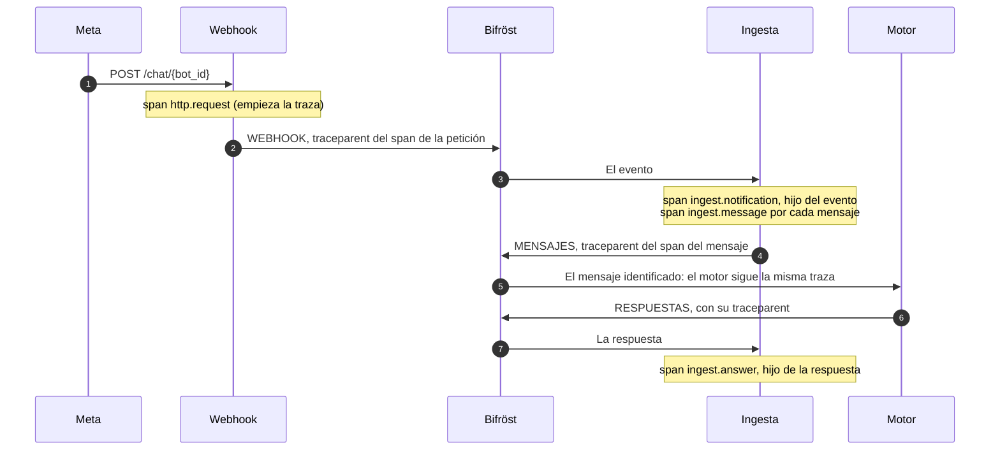

# Trazas: cómo se sigue un mensaje de un servicio a otro

* **Estado:** review
* **Fecha:** 2026-10-19
* **Decisores:** Jeremi Alcala
* **Fase AI-DLC:** 03-implementation
* **Versión:** 0.1.0
* **Requisitos:** RNF09, RS19
* **Incremento:** I5 del [plan de la topología de workers](../00-project/plan-topologia-de-workers.md) (R4)

Cada servicio del gateway emite spans con OpenTelemetry (SDK 1.45.0). El contexto W3C (`traceparent`) viaja en cada
evento del bus, así que un mensaje se sigue entero en una sola traza: desde el webhook, por la ingesta, hasta el
mensaje identificado que lee el motor. Todos los spans salen de `shared/tracing`.

## Una traza por mensaje

*Eje comportamiento · fase 03. La traza empieza en el webhook. No se toma de la petición: lo que mande el llamante
no entra en una traza (RS19).*

| Span | Servicio | Padre |
|---|---|---|
| `http.request` | Webhook y API de gestión, uno por petición, salvo `/health`: Docker lo llama cada 30 s y su traza no dice nada | Ninguno: empieza la traza |
| `ingest.notification` | Ingesta, uno por evento de `WEBHOOK` | El `traceparent` del evento |
| `ingest.message` | Ingesta, uno por mensaje | `ingest.notification` |
| `ingest.answer` | Ingesta, uno por respuesta de `RESPUESTAS` | El `traceparent` de la respuesta |
| `erasure.notices` | API de gestión, al borrar | La petición del borrado |

Cada evento publicado lleva en `traceparent` el contexto del span que lo publica: la notificación, el del
`http.request`; el mensaje identificado, el de su `ingest.message`; los avisos de supresión, el de
`erasure.notices`.

## La regla de los logs, también en las trazas (RS19, T28)

- **Ninguna biblioteca se instrumenta sola.** La instrumentación de FastAPI guarda la URL con su query string, donde
  Meta manda el token de verificación, y la dirección de quien llama. Por eso no se usa ningún paquete
  `opentelemetry-instrumentation-*`.
- **Un span solo admite los atributos de una lista cerrada** (`tracing.ALLOWED`), y cada uno con un valor de la
  forma que espera:

  | Atributos | Valor |
  |---|---|
  | `gateway.bot_id`, `gateway.client_id`, `gateway.contact_id` | Un UUID: los identificadores que dio el servicio, nunca un número ni un PSID |
  | `gateway.messages`, `http.response.status_code` | Un entero |
  | `gateway.channel`, `gateway.entity`, `gateway.outcome`, `messaging.system`, `http.request.method` | Una palabra de su lista |
  | `http.route` | La ruta tal como está declarada (`/chat/{bot_id}`), nunca la dirección que llegó |
  | `messaging.destination.name` | El nombre de un stream o un sujeto de Bifröst |
  | `error.type` | El nombre de la clase de la excepción |

  Lo demás se queda fuera. El log dice qué clave fue, nunca su valor.
- **Una excepción nunca se guarda en un span**, porque su texto puede llevar cualquier cosa. Un span que falla
  dice el tipo de fallo en `error.type` y queda en estado `ERROR`, sin descripción.
- **Una prueba lo comprueba**, como la de los logs: `tests/unit/test_traces.py`. Recorre el webhook, la ingesta y la
  gestión con un número, un texto, un nombre, un token de verificación en la query y el App Secret, y mira que nada
  de eso aparezca en ningún span.

## Dónde van

Los spans se exportan por OTLP/HTTP solo si `OTEL_EXPORTER_OTLP_ENDPOINT` dice adónde; el exportador lee también el
resto de las variables `OTEL_EXPORTER_OTLP_*`. Si no está, los spans se crean pero no salen del proceso. El contexto
sigue viajando con cada evento, y quien trace después lo recibe.

**Van a Saga**, el Grafana Tempo de Yggdrasil (ADR-0008 de Yggdrasil). Guarda 15 días en el SSD de midgard y se
consulta desde Odín, la fuente de datos `Saga`.

- **Cómo llegan:** en el compose, los tres servicios entran en la red externa `yggdrasil_saga` y envían a
  `http://saga:4318`. Esa red solo lleva a Saga, no a Mimir ni a Odín. El webhook está expuesto a internet y no entra
  en `heimdall`.
- **Cómo se llaman:** cada servicio se identifica con `OTEL_SERVICE_NAME`: `gateway-webhook`, `gateway-management` y
  `gateway-ingest`.
- **Si Saga no responde:** el exportador trabaja en segundo plano, por lotes, y no frena ninguna petición. Los spans
  que no puede entregar se pierden y deja un aviso en el log. Yggdrasil avisa con `SagaCaida`.
- **Requisito de arranque:** Yggdrasil tiene que estar levantado antes que el gateway, porque la red la crea su
  compose.

## Probado en midgard (2026-10-19)

Con Saga desplegada (Yggdrasil 0.5.14) y el compose de esta rama:

- Una notificación firmada dejó en Saga una traza con tres spans y dos servicios: `http.request` en
  `gateway-webhook`, y `ingest.notification` → `ingest.message` en `gateway-ingest`.
- Cada span llevaba solo atributos de la lista.
- La traza duró 3,2 s, con la ingesta incluida; el webhook respondió antes.
- Ninguno de los tres servicios dejó avisos en el log.

Antes, sin destino de exportación:

Con la imagen `i5-3f80052`, sin destino de exportación, se envió una notificación firmada al webhook:

- el evento de `WEBHOOK` y el mensaje identificado de `MENSAJES` llevaban la misma traza, cada uno con su span;
- ninguno de los tres servicios dejó avisos ni errores en el log.
