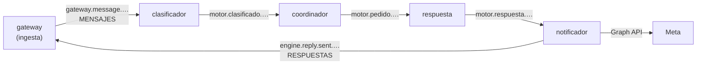

# El motor de respuestas

> **Dentro del monorepo de los chatbots.** Vive en `engine/` del repositorio `wh-python-fastapi-messenger`, junto al
> gateway que le entrega los mensajes, desde el 2026-10-20
> ([ADR-0023](../docs/00-project/adr/0023-monorepo-del-gateway-y-el-motor.md)). El repositorio
> `ms-python-metamsghandler`, donde nació, queda archivado con su historia, que también está aquí. Las órdenes de
> este README se ejecutan desde `engine/`.

Es la mitad de **Hive** que responde ([ADR-0024](../docs/00-project/adr/0024-el-producto-se-llama-hive.md)): contesta
los mensajes que las personas envían a los chatbots por WhatsApp, Messenger e Instagram. Son seis workers de
una misma imagen, uno por contenedor, que se pasan cada mensaje por Bifröst, el NATS JetStream de midgard
([ADR-0008](docs/02-design/adr/ADR-0008-seis-workers-sobre-bifrost.md)). Usan Claude por la API de Anthropic
([ADR-0009](docs/02-design/adr/ADR-0009-claude-como-llm.md)).

## El recorrido de un mensaje



Es el esqueleto: el enlace y el evaluador llegan después. El orden está en el
[plan de los workers](docs/00-project/plan-de-los-workers.md).

| Worker | Estado | Lee | Publica |
|---|---|---|---|
| Clasificador | **Construido** (E3) | `MENSAJES`, consumidor `classifier` | `motor.clasificado.{p}.{bot}.{contacto}` |
| Coordinador | **Construido** (E4) | `MOTOR`, consumidor `coordinator` | `motor.pedido.{p}.{bot}.{contacto}` |
| Respuesta | **Construido** (E5) | `MOTOR`, consumidor `responder` | `motor.respuesta.{p}.{bot}.{contacto}` |
| Notificador | **Construido** (E6) | `MOTOR`, consumidor `notifier` | `engine.reply.sent.{bot}` y Meta |

### El clasificador

`python -m src.workers.classifier`. Por cada mensaje identificado, una llamada a Claude Haiku 5.5 con salida
estructurada decide si se atiende y cuál es su intención.

- **Fail-closed:** solo sigue lo que Claude permite sin motivo para pararlo.
- **Solo el texto sale a Anthropic.**
- **Publica el sobre para el coordinador** y solo entonces confirma.

### El coordinador

`python -m src.workers.coordinator`. Si el mensaje sigue, pide al gateway la persona del bot con sus reglas y las
últimas vueltas, con su clave para el cliente dueño del bot, y pide la respuesta con Claude. Si no sigue, pide un
texto fijo según el motivo: la persona siempre recibe algo.

### El de respuesta

`python -m src.workers.responder`. Con Claude, Opus 5.5 escribe la contestación con la persona del bot y sus reglas
en el `system`, cacheado, y las vueltas y el mensaje como turnos de la conversación, con los fallbacks del servidor.
Si no, contesta el texto fijo que pidió el coordinador, o el de «no puedo» si Claude rechaza.

### El notificador

`python -m src.workers.notifier`. Envía el texto por la Cloud API de WhatsApp, con el token del bot que le da el
gateway, y publica lo enviado para el historial del gateway. Antes de enviar mira el bucket `enviados` de Bifröst, para
no enviar dos veces la misma respuesta. Messenger e Instagram llegan en el E10.

El sobre que se pasan los workers es el contrato interno del motor,
[`asyncapi-motor.yaml`](docs/02-design/contracts/asyncapi-motor.yaml).

## Estructura

```text
src/
├── domain/
│   ├── models/sobre.py              # el sobre de los workers, versión 1
│   └── ports/                       # ClasificadorDeEntrada, FuenteDelBot, Redactor, y los del envío
├── infrastructure/
│   ├── claude/                      # ClaudeClasificador y ClaudeRedactor (SDK anthropic)
│   ├── gateway/                     # ApiDelGateway: la API de gestión, con la clave del worker
│   ├── meta/                        # WhatsAppCloud: la Cloud API de WhatsApp
│   ├── bifrost/                     # EnviadosEnBifrost: el bucket `enviados`
│   └── adapters/sanitize.py         # el saneado del texto antes de salir
└── workers/
    ├── runtime.py                   # el bucle común: atarse al consumidor, leer, publicar, confirmar
    ├── settings.py                  # la configuración de cada worker, del entorno
    ├── classifier.py                # el clasificador
    ├── coordinator.py               # el coordinador
    ├── responder.py                 # el de respuesta
    └── notifier.py                  # el notificador
tests/                               # unit, contract e integration (contra un NATS)
docs/                                # documentación AI-DLC por fase (00 a 06)
```

Lo que el motor comparte con el gateway (el bus, las trazas, los contratos v2, el almacén de claves de Andvari) está
en `shared/`, en la raíz del monorepo.

## Configuración

Del entorno del contenedor. Ningún secreto va en ella:

| Variable | Qué |
|---|---|
| `NATS_URL`, `NATS_USER`, `NATS_PASSWORD`, `NATS_CA`, `NATS_INBOX_PREFIX` | Bifröst. Las deja `credenciales/<worker>.env` del repositorio `bifrost` |
| `ANDVARI_ADDR`, `ANDVARI_CA_FILE` | Andvari |
| `ENGINE_ROLE_ID`, `ENGINE_SECRET_ID_FILE` | El rol AppRole `motor-<worker>` y el fichero con su `secret_id` |
| `CLASSIFIER_MODEL`, `CLASSIFIER_EFFORT`, `CLASSIFIER_MAX_TOKENS`, `CLASSIFIER_TIMEOUT`, `CLASSIFIER_MAX_RETRIES` | El clasificador. Por defecto: `claude-haiku-5-5`, `low`, 1024, 7 s y 2 |
| `GATEWAY_URL`, `GATEWAY_AUDIENCE`, `GATEWAY_PUBLIC_KEYS_FILE`, `GATEWAY_CA_FILE`, `COORDINATOR_TIMEOUT` | El coordinador: la API del gateway, como para `ops.engine_keys`. El timeout, 5 s por llamada |
| `RESPONDER_MODEL`, `RESPONDER_EFFORT`, `RESPONDER_MAX_TOKENS`, `RESPONDER_TIMEOUT`, `RESPONDER_MAX_RETRIES` | El de respuesta. Por defecto: `claude-opus-5-5`, `medium`, 4096, 50 s y 1 |
| `GATEWAY_*` (como el coordinador), `GRAPH_URL`, `GRAPH_VERSION`, `NOTIFIER_TIMEOUT` | El notificador. Por defecto: `https://graph.facebook.com`, `v26.0` y 8 s por llamada |
| `LOG_LEVEL` | `INFO` por defecto. El log va al stdout del contenedor |

La clave de la API de Anthropic de cada worker la lee el worker de Andvari al arrancar, de
`motor/data/anthropic/<worker>`. La pone el operador con `motor/clave-anthropic.sh` del repositorio `andvari`.

## Desarrollo y pruebas

Python 3.12. Las dependencias se instalan desde los locks, con hashes (`requirements.lock` y `requirements-dev.lock`;
cómo regenerarlos, en el `CONTRIBUTING.md` de la raíz). Las pruebas no llaman a la API de Anthropic: el clasificador
se prueba con el SDK de verdad y un transporte HTTP falso.

```bash
# Desde engine/. Las de integración necesitan un NATS como Bifröst; sin NATS_TEST_ADDR se saltan.
docker run -d --rm --name nats-motor -p 127.0.0.1:24222:4222 \
  -v "$PWD/tests/integration/nats-test.conf:/etc/nats/test.conf:ro" nats:2.14.8-alpine -c /etc/nats/test.conf
pip install --require-hashes -r requirements-dev.lock
pylint --rcfile=pyproject.toml src
NATS_TEST_ADDR=127.0.0.1:24222 python -m pytest --cov=src --cov-branch --cov-fail-under=80

# La imagen, desde la raíz del monorepo, que es donde está shared/
docker build -f Dockerfile -t chatbot-engine ..
```

El CI (workflows `engine` y `build-engine`) hace lo mismo, con el NATS y con las pruebas de integración obligatorias.

## Despliegue

Todavía no está desplegado: el esqueleto se despliega en midgard en el E7, un contenedor por worker, junto a Bifröst
y Andvari.

## Metodología AI-DLC

El motor sigue el estándar AI-DLC ([ADR-0001](docs/00-project/adr/0001-adopcion-estructura-ai-dlc.md)).

| Carpeta | Contenido |
|---|---|
| [`docs/`](docs/README.md) | Charter, requisitos, arquitectura, threat model, ADRs y contratos, por fase |
| [`.ai-dlc/`](.ai-dlc/) | Checklists de los gates 0 a 5 con su estado, plantillas y mapeo OWASP |
| [`tests/`](tests/README.md) | Pirámide de pruebas |
| [`CHANGELOG.md`](CHANGELOG.md) | Cambios notables |
| [`SECURITY.md`](SECURITY.md) · [`CONTRIBUTING.md`](CONTRIBUTING.md) | Política de seguridad y flujo de trabajo |

Ningún gate está cerrado todavía. La arquitectura y el threat model describen aún el servicio de antes, el de
RabbitMQ, NeMo y Ollama: se rehacen con ADR-0008 y ADR-0009 antes de cerrar el Gate 1 del motor.

## Autor

**Jeremi Alcalá** — [github.com/jeremialcala](https://github.com/jeremialcala)
