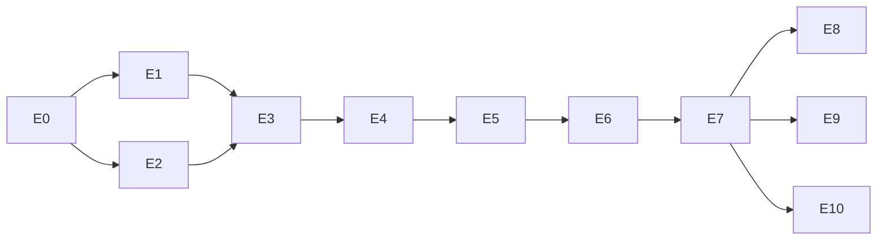

# Plan: el motor en seis workers, primero de punta a punta

* **Estado:** review
* **Fecha:** 2026-10-20
* **Decisores:** Jeremi Alcala
* **Fase AI-DLC:** 00-project
* **Versión:** 0.1.0
* **ADRs:** [ADR-0008](../02-design/adr/ADR-0008-seis-workers-sobre-bifrost.md) (topología),
  [ADR-0009](../02-design/adr/ADR-0009-claude-como-llm.md) (Claude como LLM); ADR-0022 y ADR-0023 del gateway

## Decisiones de partida (Jeremi, 2026-10-20)

- **Monorepo.** El motor vive en `engine/` del repositorio del gateway (ADR-0023 del gateway).
- **LLM:**
  - Claude, por la API de Anthropic;
  - Haiku 5.5 para clasificar y Opus 5.5 para responder y evaluar;
  - sin retención cero por ahora: se pide antes del primer cliente real.
- **Esqueleto de punta a punta primero.** Un mensaje de WhatsApp recibe una respuesta real cuanto antes. Después se
  profundiza en cada worker y llegan el enlace y el evaluador.

## Incrementos

| # | Qué | Dónde | Depende de |
|---|---|---|---|
| E0 | **Diseño:** ADR-0008, ADR-0009, este plan y la clasificación de datos con Anthropic. Las ADR-0003, 0004, 0005 y 0007 del motor quedan superadas | `engine/docs/` | — |
| E1 | **`shared/`.** Se extraen del gateway, y el gateway pasa a usarlos sin cambiar de comportamiento: el bus, las trazas, los tokens de la API, `EngineKeyStore`, la regla de destinos y los nombres de los workers. El contrato v2 queda en modelos (`shared.contract`), probados por los dos lados. La imagen del motor se construye desde la raíz para llevar `shared/`. **Hecho** (2026-10-20) | `shared/`, `src/`, `engine/` | E0 |
| E2 | **Bifröst para el motor:** el stream `MOTOR` (24 h); los consumidores de los cuatro workers del esqueleto, más el del clasificador sobre `MENSAJES`; y un usuario por worker con sus sujetos (I6c del gateway) | repo `bifrost` y midgard | E0 |
| E3 | **Clasificador.** Lee `MENSAJES` y, en una llamada a Haiku 5.5 con salida estructurada y fail-closed, decide la seguridad y la intención. Publica `motor.clasificado.…`. Retira NeMo, Ollama, `annoy` y el consumidor AMQP. Con él nace el contrato interno del motor (`asyncapi-motor.yaml`): se pasó aquí desde el E1 porque es donde aparece su primer productor. Va en dos PR: **E3a**, el clasificador, el sobre y su contrato, con la política de Andvari para su clave de Anthropic (lo construido está en ADR-0008 y ADR-0009), **hecho** (#67, 2026-10-20); **E3b**, retirar lo de antes | `engine/`, repo `andvari` | E1, E2 |
| E4 | **Coordinador.** Pide al gateway las reglas y las últimas vueltas, con su clave, y publica `motor.pedido.…`. En el esqueleto no llama al enlace. Un mensaje que no sigue se pide con un texto fijo según su motivo, y `GET /rules` del gateway pasa a devolver datos (decisiones de Jeremi del 2026-10-20; lo construido, en ADR-0008) | `engine/`, `src/` | E3 |
| E5 | **Respuesta.** Opus 5.5 con la persona y las reglas en el `system`, cacheado, y las vueltas y el mensaje como turnos de usuario. Publica `motor.respuesta.…`. Escribe también los textos fijos que pide el coordinador (lo construido, en ADR-0009) | `engine/` | E4 |
| E6 | **Notificador.** Pide los tokens de Meta al gateway y envía el texto por la Cloud API de WhatsApp, deduplicando por mensaje con el bucket `enviados` de Bifröst (decisión de Jeremi del 2026-10-20). Publica `engine.reply.sent.{botId}`, que la ingesta del gateway guarda en el historial (lo construido, en ADR-0008) | `engine/`, repo `bifrost` | E5 |
| E7 | **Despliegue del esqueleto en midgard:** un contenedor por worker, la clave de la API de Anthropic y los `secret_id` de cada rol en Andvari, y una prueba con un bot de WhatsApp de verdad. **Aquí el esqueleto responde de punta a punta.** Se mide la latencia y el coste por mensaje | midgard | E6 |
| E8 | **Evaluador.** Opus 5.5 revisa la respuesta, y el notificador pasa a leer `motor.aprobada.…` | `engine/` | E7 |
| E9 | **Enlace.** Las acciones de los intents, con los destinos comprobados al llamar: se resuelve el nombre, se comprueba cada dirección y no se siguen redirecciones (I7 del gateway) | `engine/` | E7 |
| E10 | **Messenger e Instagram** en el notificador, y el control de tasas de Meta | `engine/` | E7 |

## Lo que no es del esqueleto

- **Varias particiones en paralelo:** el esqueleto atiende un mensaje en vuelo por worker (ADR-0008).
- **La batería de evaluación del clasificador y del de respuesta** con mensajes reales anonimizados: antes del Gate 3
  del motor.
- **ZDR y el DPA de Anthropic:** antes del primer cliente real.
