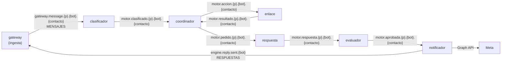

# ADR-0008: El motor, seis workers sobre Bifröst

* **Estado:** accepted
* **Fecha:** 2026-10-20
* **Decisores:** Jeremi Alcala
* **Fase AI-DLC:** 02-design
* **Versión:** 0.1.0
* **ID:** ADR-0008
* **Supersede:** ADR-0003 (consumo AMQP con un hilo por mensaje y confirmación manual)
* **OWASP:** A01 (cada worker solo alcanza lo suyo), A04 (TLS hasta Bifröst), A09 (trazas sin datos personales)

Aceptada el 2026-10-20 al fusionar la PR #65.

## Contexto

El plan de la topología de workers del gateway (`docs/00-project/plan-topologia-de-workers.md`, en la raíz del
monorepo) parte el motor en seis workers. Hoy el motor es uno solo, y solo clasifica:

- lee de RabbitMQ con `pika` síncrono, con un hilo por mensaje y `prefetch=1`;
- pasa el mensaje por NeMo y Ollama;
- publica un `ResultadoClasificado` en una cola que nadie lee.

Además descarta `botId`, `clientId`, `messageId` y el contacto, y un `nack` pierde el mensaje.

Lo que ya está construido del otro lado:

- **El gateway publica en Bifröst** (NATS JetStream 2.14) cada mensaje identificado, en
  `gateway.message.{partición}.{botId}.{contactId}`, stream `MENSAJES`. La partición son 16 particiones, por un
  hash del bot y el contacto. El evento lleva `Nats-Msg-Id = {botId}:{messageId}` y el `traceparent`
  (`docs/02-design/contracts/asyncapi-v2.yaml`).
- **El historial de las respuestas** espera lo que el notificador envió en `engine.reply.sent.{botId}`, stream
  `RESPUESTAS`.
- **Cada worker tiene su clave de servicio para la API de gestión**, con sus rutas (ADR-0022 del gateway). La parte
  privada está en Andvari, en `motor/data/clientes/<cliente>/<worker>`, y cada worker la lee con su rol
  `motor-<worker>`.
- **Los destinos de los intents se validan al guardarlos** (I7). El worker de enlace tiene que volver a comprobarlos
  al llamar.

## Decisión

**Seis workers en la imagen del motor, uno por contenedor, que se pasan el mensaje por Bifröst.** Cada worker es un
punto de entrada de la misma imagen (`python -m src.workers.<worker>`), con su configuración, su clave, su rol de
Andvari y su usuario de Bifröst.

### El recorrido de un mensaje

| Worker | Lee | Publica | Alcanza en la API del gateway |
|---|---|---|---|
| Clasificador | `gateway.message.>` (MENSAJES) | `motor.clasificado.…` | Reglas |
| Coordinador | `motor.clasificado.…`, `motor.resultado.…` | `motor.pedido.…`, `motor.accion.…` | Reglas, herramientas, vueltas |
| Enlace | `motor.accion.…` | `motor.resultado.…` | Herramientas |
| Respuesta | `motor.pedido.…` | `motor.respuesta.…` | Reglas |
| Evaluador | `motor.respuesta.…` | `motor.aprobada.…` | Reglas |
| Notificador | `motor.aprobada.…` | `engine.reply.sent.{botId}` (RESPUESTAS) y la Graph API de Meta | Tokens de Meta |

1. **Un stream propio, `MOTOR`**, con los sujetos `motor.>`.
   - Guarda los mensajes **24 horas**, que basta para reintentar y para mirar qué pasó.
   - Llevan el texto de la persona, así que no se guardan más: es un sitio más en el derecho de supresión
     (Datos, abajo).
   - Usa `sync_interval: always`, como los demás streams de Bifröst (ADR-0019 del gateway).
2. **Cada sujeto lleva la partición, el bot y el contacto**, como los del gateway. La partición es la del evento
   original y nadie la vuelve a calcular.
3. **Un consumidor duradero por worker**, de tipo pull, con su filtro de sujetos.
   - Lo crea el aprovisionamiento de Bifröst, no el worker, que solo se ata a él, igual que la ingesta del gateway.
   - Confirma después de publicar lo que sigue. Si un mensaje falla, se reintenta con `max_deliver` y con espera
     creciente; al agotar los intentos, sale en un aviso. Nunca se pierde en silencio.
4. **Cada paso deduplica al publicar**, con `Nats-Msg-Id = {paso}:{botId}:{messageId}`. Un reintento dentro de la
   ventana de Bifröst no duplica la respuesta. El notificador comprueba además, antes de enviar, que esa respuesta
   no salió ya: Meta reintenta durante días, y la ventana es de minutos.
5. **El orden por conversación.** Dos mensajes seguidos de la misma persona se responden en orden: cada consumidor
   tiene un solo mensaje en vuelo por partición. En el esqueleto, `max_ack_pending: 1` por consumidor ordena todo;
   las particiones paralelas llegan cuando haga falta el caudal (su condición de revisión).
6. **El contexto viaja en el mensaje.** Cada paso añade lo suyo a un sobre que crece y no guarda nada en memoria
   entre mensajes:
   - el clasificador, la intención;
   - el coordinador, las reglas y las vueltas;
   - el de respuesta, el texto;
   - el evaluador, su veredicto.

   Así cualquier réplica puede atender cualquier mensaje. El sobre es el contrato interno del motor, versionado
   con `schemaVersion`. Se escribe con el primer worker, en `engine/docs/02-design/contracts/asyncapi-motor.yaml`.
7. **La traza sigue un solo hilo.** Cada worker abre su span desde el `traceparent` que llega y lo pasa al mensaje
   que publica, con la lista cerrada de atributos del gateway (I5).
8. **El código que comparten el gateway y los workers va a `shared/`** (ADR-0023 del gateway):
   - el contrato v2;
   - la firma de los tokens y el almacén de claves de Andvari;
   - el publicador y el consumidor de NATS;
   - las trazas;
   - la regla de los destinos.
9. **Lo que hay hoy en `src/` se reaprovecha en el clasificador:** el normalizador, el saneado y el enum de
   orígenes. El consumidor AMQP y el publicador se retiran cuando el clasificador lea de Bifröst. Su ADR-0003
   queda superada por esta.

### El esqueleto primero (decisión de Jeremi, 2026-10-20)

El primer objetivo es que un mensaje de WhatsApp reciba una respuesta real, de punta a punta. Para eso, en el
esqueleto el coordinador no llama al enlace y el notificador lee `motor.respuesta.…` directamente, sin evaluador.
El enlace y el evaluador llegan después: el evaluador entra cambiando el sujeto que lee el notificador, no su
código. El orden está en `engine/docs/00-project/plan-de-los-workers.md`.

## Alternativas consideradas

| Opción | Pros | Contras | Riesgo de seguridad |
|---|---|---|---|
| **Seis workers por Bifröst, una imagen, un stream propio** | Cada worker escala y falla por su cuenta, y solo alcanza lo suyo (clave, rol, usuario). Un solo CI y una sola cadena de dependencias | Siete saltos por el bus, con un `fsync` cada uno en el disco de midgard (44,5 ms medidos) | El texto vive 24 h en el stream. Lo mitiga la retención corta, el TLS y un usuario por worker |
| Un solo proceso con las etapas en memoria | Sin saltos, la latencia más baja | Una credencial con todas las rutas (lo que ADR-0022 cierra). Un fallo de una etapa tumba todas, y no escala por etapas | Una clave robada alcanza los tokens de Meta y todo lo demás |
| Seis workers por RabbitMQ (Hermod) | Ya está desplegado | Hermod se retira (D1 del gateway). Sin deduplicación al publicar | Igual que la elegida, con un broker que se va |
| Llamadas HTTP síncronas entre workers | Sencillo de razonar | Un worker caído pierde el mensaje o bloquea al anterior; habría que inventar los reintentos | Cada worker expone un puerto |

## Consecuencias

- **Bifröst crece:**
  - el stream `MOTOR`;
  - un consumidor por worker y un usuario por worker con sus sujetos (I6c del gateway);
  - el consumidor del clasificador sobre `MENSAJES`.

  Se aprovisiona en el repo `bifrost`.
- **Andvari:** emitir el `secret_id` de cada rol `motor-<worker>` al desplegarlo, con `raiz-temporal.sh`.
- **La latencia:** el presupuesto de RNF01 (250 ms) es del webhook, no de la respuesta. La respuesta la dominan las
  llamadas a Claude. Los siete `fsync` (unos 300 ms en el HDD de midgard) se miden en el esqueleto.
- **El sobre interno tiene contrato y pruebas de contrato**, como el v2 del gateway.
- **Supresión:** los workers no guardan estado. El stream `MOTOR` caduca a las 24 h y no se purga por contacto: lo
  que se borra antes de caducar lo dice la clasificación de datos.

## Condiciones de revisión

- El caudal pide más de un mensaje en vuelo: entonces, un consumidor por grupo de particiones.
- La latencia medida de los saltos por Bifröst pesa frente a la de Claude.
- Un worker necesita estado propio entre mensajes.
